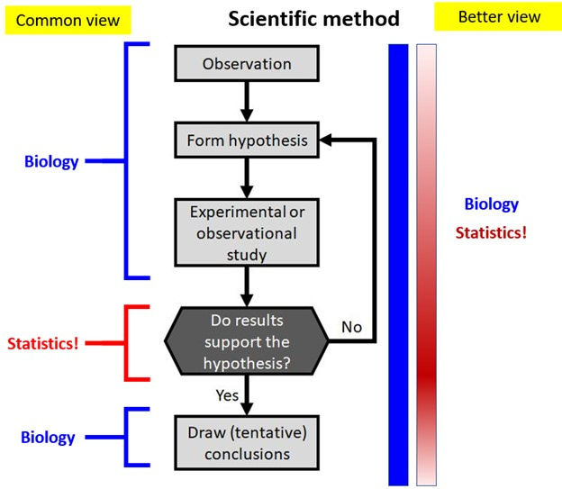
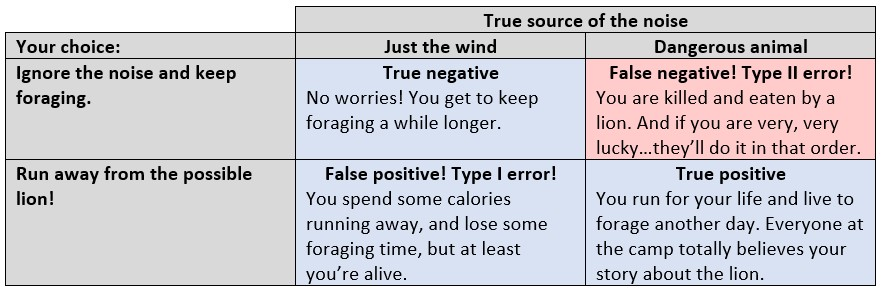
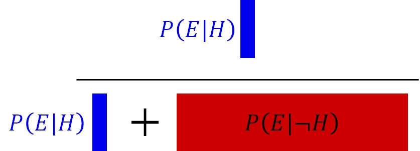

# Introduction: Modes of inference {#sec-intro}


## Motivation: hypothesis testing in biology {#sec-intro-motiv}

Biology, like all sciences, depends on the **scientific method**. This means testing proposed explanations, or **hypotheses**, against the data to see if the data support the hypothesis or not. That critical step, of deciding whether observations support or refute a hypothesis, is the domain of **statistics**: the branch of mathematics concerned with finding and interpreting patterns in data.

Many biologists traditionally think of "biology" and "data analysis" as two completely separate enterprises, with statistics being like a special wrench that a mechanic pulls out of the toolbox so infrequently that its use is unfamiliar. I think this is a mistake. As the figure below shows, every part of the scientific method can benefit from some knowledge of statistics. This includes experimental design, data collection, and interpreting the findings.

{fig-align="center" label=fig-scimethod}

So why do we, as biologists, need statistics? Some common answers might include:

1.  "To tell us whether the patterns we see in our data are real"

2.  "To tell whether the patterns in our data are due to chance or not."

3.  "To prove our hypotheses."

All 3 of these are completely wrong. **1** is wrong because confirming reality requires observation and experiment, not calculating. **2** is a common misconception. *Any* pattern in data could be cause by chance. Statistics can help you estimate that probability, but cannot tell you for sure. Finally, **3** is wrong because that's not how science works. Hypotheses can be supported or not supported. No amount of statistical analysis will ever completely rule out chance.

Strange as it may seem, though, **2** actually has a lot to do with how most statistical analysis in biology is done, and has for most of the last century. 

## Null hypothesis significance testing and *p*-values {#sec-intro-nhst}

### Introduction {#sec-intro-nhst-intro}

When scientists design experiments, they are testing one or more hypotheses, or proposed explanations for a phenomenon. Contrary to popular belief, the statistical analysis of experimental results usually does not test a researcher's hypotheses directly. Instead, statistical analysis of experimental results focuses on comparing experimental results to the results that *might have occurred* if there was no effect of the factor under investigation.

In other words, traditional statistics sets up the following:

-   **Null hypothesis or** $H_0$: default assumption that some effect (or quantity, or relationship, etc.) is zero and does not affect the experimental results.

-   **Alternative hypothesis or** $H_a$: assumption that the null hypothesis is false. Usually this is the researcher's scientific hypothesis, or proposed explanation for a phenomenon. Also sometimes called $H_1$.

In (slightly) more concrete terms, if researchers want to test the hypothesis that some factor $X$ has an effect on measurement $Y$, then they set up an experiment comparing observations of $Y$ across different values of $X$. They would then have the following set up:

-   **Null hypothesis:** Factor $X$ does not affect $Y$.

-   **Alternative hypothesis:** Factor $X$ does affect $Y$

Notice that the alternative hypothesis is the **logical negation** of the null hypothesis: the alternatives "does not affect" and "does affect" cover all possibilities. There is no "sort of affects".

{fig-align="center" fig-alt="Master Yoda reminds us that the null hypothesis and the alternative hypothesis must cover all logical possibilities." label=fig-yoda}

The alternative hypothesis is also ***not*** a statement about another variable (e.g., "Factor $Z$ affects $Y$"). This is an easy mistake to make and one of the weaknesses of NHST: the word "hypothesis" in the phrase "null hypothesis" is not being used in the sense that scientists usually use it. This unfortunate choice of vocabulary is responsible for generations of confusion among researchers[^nullh].

[^nullh]: Not to mention among generations of students taking statistics courses, myself included.

In order to test an "alternative hypothesis", what need is to *estimate* how likely the data would be if the null hypothesis were true. If a pattern seen in the data is highly unlikely, this is taken as evidence that the null hypothesis should be rejected in favor of the alternative hypothesis. This is not the same as "accepting" or "proving" the alternative hypothesis.

The null hypothesis is usually translated to a prediction like one of the following:

- The mean of $Y$ is the same for all levels of $X$.
- The mean of $Y$ does not differ between observations exposed to $X$ and observations not exposed to $X$.
- Outcome $Y$ is equally likely to occur when $X$ occurs as it is when $X$ does not occur.
- Rank order of $Y$ values does not differ between levels of $X$.

All of these predictions have something in common: $Y$ is **independent** of $X$. That's what the null hypothesis means. To test the predictions of the null hypothesis, we need a way to calculate what the data *might have looked like if the null hypothesis was correct*. Once we calculate that, we can compare the data to those calculations to see how "unlikely" the actual data were. Data that are sufficiently unlikely under the assumption that the null hypothesis is correct---a pattern that is **statistically significant**---are a kind of evidence that the null hypothesis is false. If this sounds convoluted, that's because it is.

This kind of analysis is referred to as **Null Hypothesis Significance Testing (NHST)** and is one of the most important paradigms in modern science. Whether or not this is a good thing is a subject of fierce debate among scientists, statisticians, and philosophers of science. For better or worse, NHST is all but the *de facto* standard of inference in scientific publishing, so regardless of its merits in your particular case you will need to be able to use it. The purpose of this course module is to encourage you to use it correctly.

The *p*-value allows us to make binary distinctions, in a systematic way, between situations where a null hypothesis is true and no pattern is present, and situations where the null hypothesis is highly unlikely to be true and thus a pattern might be present. Any binary decision process has four possible outcomes:

1. **True positive**: declare a pattern is present when it is present.
2. **True negative**: declare a pattern is absent, when it is absent.
3. **False positive**: declare a pattern is present, when it is actually absent. Also called a **Type I error**.
4. **False negative**: declare a pattern is absent, when it is actually present. Also called a **Type II error**.

These outcomes can be summarized as shown below. Statisticians are particularly concerned with the probabilities of false positives ($\alpha$) and false negatives ($\beta$). The false positive probability $\alpha$ is the standard against which experimental *p*-values are compared. This is largely because we humans are inordinately prone to finding patterns even when no patterns are present--i.e., committing type I errors.

{fig-align="center" label=fig-errors1}

Why have we evolved this way? Finding patterns in noisy data has helped us discover virtually everything we know. So, pattern recognition must be a powerful cognitive tool. But there is another interpretation, that in our ancestral lifestyle life false positives were far less costly than false negatives. Imagine you are an Australopithecine or an early *Homo erectus* (or *H. sapiens*, for that matter), wandering through the savanna of what will someday be modern Ethiopia, looking for food. You hear a rustle in the tall grass a few meters ahead. Is that rustle just the wind? Or is it a dangerous animal that will kill and possibly eat you? Here are your choices and their consequences:

{fig-align="center" label=fig-labels2}

Notice that of your choices, only the type II error has immediate evolutionary consequences. In terms of fitness, the difference between a type II error and a true positive (death vs. survival) is much greater than the difference between a true negative and a false positive (a bit more food vs. a mild inconvenience).

What does this have to do with statistics in biology? Our human minds have evolved to find patterns in noisy data, and we are so good at it that we frequently “find” patterns that aren’t really there. So, we use the scientific method and statistical analysis as tools to help mitigate our bias toward pattern-finding.

### Example {#sec-intro-nhst-example}

Let's do a quick example of null hypothesis significance testing. We'll use the famous `iris` dataset, which is built into R. It contains measurements of 4 different parts of 150 *Iris* flowers, with 50 from each of three species (*I. setosa*, *I. versicolor*, and *I. virginica*). We are going to use NHST to investigate whether the three species have different petal lengths. 

{fig-align="center" label=fig-iris1}

Our research question is:

**Do different species of *Iris* differ in their petal lengths?**

Since we already have the measurements, one good first step would be a make a plot of the petal sizes in each species. The best tool for this kind of question is a **boxplot**, or **box-and-whiskers plot**.

```{r}
#| fig-cap: "Variation in petal length among 3 species of *Iris*"
#| label: fig-iris1
boxplot(Petal.Length~Species, data=iris)
```

The boxplot shows us that petal lengths for *I. setosa* are clustered around 1.5 cm, about 4.5 cm for *I. versicolor*, and about 6 cm for *I. virginica*. Can we conclude that petal lengths differ between species?

No, not yet. Obviously, there is some intraspecific (within-species) variation in petal length, and some interspecific variation. And, it sure looks like *I. setosa* is quite a bit smaller than the other two species. *I. versicolor* and *I. virginica* look like they might be different, but there is some overlap. So no, we can't answer our question just by eyeballing the figure.

If you think about it for a while, you might think of another question: what does it even mean for the species to have different petal lengths? No overlap in size at all? Only 1% overlap? Only 2%? What is the threshold? And even if you could think of a threshold, how would you defend it against other scientists who have other ideas about flower petal lengths?

To answer that question, what does "different" even mean, we have to realize that these 150 flowers are not all of the flowers. They are a sample of millions or billions of flowers. And even if we could measure every single *Iris* flower on Earth, those untold billions are an infinitesimally tiny fraction of all of the *Iris* flowers that there ever could have been. So, the means of our three species of flowers are not the true, underlying, eternal Platonic ideal means of all *Iris*. They are the means of a *sample* of *Iris*: **sample means**, often labeld $\bar{x}$. That unknown, unobservable quantity that underlies the samples is the **population mean**: the mean of all possible flowers. The population mean is usually denoted $\mu$. We can obtain a sample mean, but only ever estimate the population mean. Likewise, each species appears to have a sample SD calculated from the data, $s$, and a population SD $\sigma$ that we can only estimate.

```{r}
# estimate the sample mean of petal length
aggregate(Petal.Length~Species, data=iris, mean)
```

```{r}
# calculate sample SD of petal length
aggregate(Petal.Length~Species, data=iris, sd)
```


With that in mind, we now have a way to define a "difference" between species in terms of petal length: could we collect a sample of these 3 species, assuming they had the same $\mu$ and $\sigma$, and observe a difference between groups as large as the one we saw in @fig-iris1? If the population means are the same, then observing a consistent difference should be very, very unlikely. If it is so unlikely that we reject that possibility, then we can tentatively accept the alternative: that the population means are not the same, and are different.

So, our question of "Do different species of *Iris* differ in their petal lengths?" can be rephrased into a statistical question:

**Do different speceies of *Iris* have different population means?**

Our research hypothesis is that they do. Thus, the null hypothesis, the hypothesis of no effect, must be:

$H_0$: The three species of *Iris* have the same population mean.

and for $H_1$ to cover all possibilities:

$H_1$: At least one species of iris must have a different population mean than the other species.

That $H_1$ covers the possibilities of 1 pairwise difference in $\mu$, 2 pairwise differences in $\mu$, and 3 pairwise differences in $\mu$. That is, all cases other than 0 pairwise differences.

The test for this situation is **analysis of variance (ANOVA)**:

```{r}
mod1 <- aov(Petal.Length~Species, data=iris)
summary(mod1)
```

The result of `summary()` is the **ANOVA table**. the ANOVA table shows us that the factor `Species` uses 2 degrees of freedom (variously abbreviated as DF, Df, or d.f.) to account for 437.10 of the squared errors; the residuals use 147 d.f. to account for 27.22 of the squared errors. The ratio of the mean squared error per d.f. associated with each source, 218.551 / 0.185 = 1180.2, is the test statistic $F$. This is used to calculate the *p*-value. Like most test statistics such as $t$ or $\chi^2$, $F$ follows a particular distribution defined by DF, which allows $p(F)$ to be calculated.

Under the assumption of no difference in popuation means, we would expect a random dataset to display an $F$ statistics of 1180 very, very rarely: a proportion so small that R rounds it off to 0.00000000000000022 (`<2e-16` or $p<2.2\times10^{-16}$), or 0.0000000000000022% of the time. In biology we can round this off to $p<0.001$ or $p<0.01$. How unlikely is $p<2.2\times10^{-16}$?

- An event with probability has about 1 chance in $4.55\times10^{15}$, or 1 to 4550000000000000 against.
- The odds of winning the Powerball average around 1 in $2.92\times10^{8}$. This means that under the null hypothesis an $F$ statistic this large is about 15 million times less likely than winning the Powerball.
- If you flipped a coin every second with $p\left(Heads\right)=2.2\times10^{-6}$, you would wait on, on average, about 144 million years until the coin came up heads. Flipping the coin that many times ($4.5\times10^{15}$) would probably wear the coin down to nothing through erosion. That's so long, that by that time the length of a day (Earth's rotation) will have changed. That is so long ago, that you would find yourself surrounded by non-avian dinosaurs, but would be safe from *Tyrannosaurus rex* because it would not evolve for another 70 million years!

### Conclusions {#sec-intro-nhst-conc}

The point is, what this *p*-value tells us is that the pattern we see in these data would be absurdly unlikely if the null hypothesis was true, and the populations means of the *Iris* species did not differ. Not impossible, but so astronomically unlikely that we can provisionally *reject* the null hypothesis. Note that we do not automatically *accept* the alternative hypothesis, because the probability of the pattern under the null is not 0. This is close to what Stephen Jay Gould meant when he wrote,

>In science, “fact” can only mean “confirmed to such a degree that it would be perverse to withhold provisional assent.” I suppose that apples might start to rise tomorrow, but the possibility does not merit equal time in physics classrooms (Gould 1983).

So at the end of this analysis, we have not established that the hypothesis is true. Instead, we have collected evidence that would have been very unlikely if the hypothesis was not true. In other words, we have quantified that $p\left(E|\lnot H\right)$ is very small.

$$\underbrace{p\left(E|\lnot H\right)}_{\text{p-value}}\qquad\neq\qquad \underbrace{p\left(H|E\right)}_{\text{what we actually want to know}}$$

:::{.callout-note}
Technically, the $E$ here is not the evidence, but "a pattern at least as extreme as that observed", which is a close enough approximation for the point I'm making.
:::

## Maximum likelihood estimation (MLE) {#sec-intro-mle}

### Introduction {#sec-intro-mle-intro}

Much of modern statistics is based on fitting models by **maximum likelihood estimation** or **MLE*. This revolves around finding model parameters that maximize the **likelihood function** of the model given the data. The likelihood describes how well different possible parameter values are supported by the observed data under a particular statistical model. A statistical model specifies the mathematical relationships among variables and the probability distribution of the observations; examples include a linear regression model or a Poisson GLM.

In symbols, we can write the likelihood function as:

$$\mathcal{L}\left(\theta|x\right)$$

where $x$ represents the observed data and $\theta$ represents one or more unobserved parameters. For the data we actually observed, the likelihood function asks: which possible values of $\theta$ would make these data more or less plausible?

Importantly, likelihood is ***not*** the probability that a particular parameter value or model is correct. Although $\mathcal{L}\left(\theta|x\right)$ is written with the parameters to the left of the vertical bar, it is based on the probability of the data given the parameters, $p\left(x|\theta\right)$, not the probability of the parameters given the data, $p\left(\theta|x\right)$. The latter is a Bayesian posterior probability (which we will explore in @sec-intro-bayes).

The takeaway is that probability asks about data when the model is known, while likelihood asks about parameter values after the data have been observed.

### Example {#sec-intro-mle-example}

Here's a quick example: imagine you have measured 5 squirrel femurs and found lengths of 63.6, 66.5, 64.2, 67.6, and 68.3 mm, yielding an observed sample mean and SD of $66.0\pm2.1$ mm. What estimate of the population mean $\mu$ that makes this set of measurements most plausible?

```{r}
a <- c(63.6, 66.5, 64.2, 67.6, 68.3)
mean(a)
```

```{r}
sd(a)
```

Consider 3 candidates for $\mu$: 64, 66, and 68. For any proposed value of $\mu$, `dnorm()` tells us the probability density of observing each femur length under a normal distribution with that mean:

```{r}
samp.sd <- 2.1
dnorm(a, mean=64, sd=samp.sd)
```

```{r}
dnorm(a, mean=66, sd=samp.sd)
```

```{r}
dnorm(a, mean=68, sd=samp.sd)
```

Because we observed more than 1 measurement, and assume that they are independent, the joint likelihood is the product of their densities:

```{r}
prod(dnorm(a, mean=64, sd=samp.sd))
```
```{r}
prod(dnorm(a, mean=66, sd=samp.sd))
```
```{r}
prod(dnorm(a, mean=68, sd=samp.sd))
```

It looks like 66 has the greatest joint likelihood across all observed data. But we can get a fuller picture if we test more values:

```{r}
#| fig.width: 8
#| fig.height: 7
#| label: fig-likelihood1

# series of possible mu to test
test.mu <- seq(60, 72, by=0.01)

# number of possible mu
n <- length(test.mu)

# set up vector to hold likelihood
# function of each candidate mu
lik <- numeric(n)

# calculate likelihoods of mu's in a loop
for(i in 1:n){lik[i] <- prod(dnorm(a, test.mu[i], sd=samp.sd))}#i

# now plot the likelihood function vs. mu
plot(test.mu, lik, type="l", lwd=3,
     xlab=expression(mu),
     ylab="Likelihood")
abline(v=mean(a), lwd=2, lty=2, col="red")
text(66.2, 0.5e-5, expression(bar(x)==66.04), adj=0, col="red")
abline(h=lik[which.max(lik)], lty=2, lwd=2, col="blue")
text(67.5, 3.4e-5, expression(hat(mu)==66.04), adj=0, col="blue")
```

In this case, the sample mean $\bar{x}=66.04$ (`mean(a)`) is the same as the $\mu$ value that maximized the joint likelihood of the 5 observed values, $\hat{\mu}=66.04$ (`test.mu[which.max(lik)]`). But, the code above only worked because we held the SD to be known and the same as the sample SD. If we didn't, we would have to search over a range of possible SD values, and find the combination of $\hat{\mu}$ and $\hat{\sigma}$ that maximized the likelihood. In that case, the profile of likelihoods would have been a surface, not a line.

```{r}
# range of population means to test
test.mu <- seq(62, 70, length=100)

# range of population SDs to test
test.sigma <- seq(1, 5, length=100)

# matrix to hold likelihood values
Lmat <- matrix(NA, nrow=100, ncol=100)

# fill LMat in a loop
for(i in 1:100){
  mu.i <- test.mu[i]
  for(j in 1:100){
    sigma.j <- test.sigma[j]
    Lmat[i,j] <- prod(dnorm(a, mean=mu.i, sd=sigma.j))
  }#j
}#i
```

```{r}
#| fig-cap: "The likelihood surface of a model with 2 parameters, $mu$ and $sigma$ resulting from a wide parameter search space,  shown as a heatmap with `image()`."
#| label: fig-heat1


# make the heatmap

## sequence of breaks
brks <- seq(min(Lmat), max(Lmat), length=21)

## colors (length of brks - 1)
cols <- topo.colors(20)

# wide panel for plot, narrow panel for legend
layout(matrix(c(1, 2), nrow=1), widths=c(5, 1))

# likelihood surface
par(mar=c(4.1, 4.1, 1.1, 0.1))
image(x=test.sigma, y=test.mu, z=t(Lmat),
      breaks=brks, col=cols,
      xlab=expression(sigma),
      ylab=expression(mu))

# color legend
par(mar=c(0.1, 0.1, 0.1, 4))

image(
  x=1,
  y=brks,
  z=matrix(brks[-1], nrow=1),
  breaks=brks,
  col=cols,
  xaxt="n", yaxt="n",
  xlab="",
  ylab="Likelihood"
)
axis(4, las=1)
mtext("Likelihood", side=4, line=2.5)
```

The surface above shows that the joint likelihood peaks at around $\hat{\mu}=66$ and $\hat{\sigma}=2$. We can zoom in a bit and narrow our search:

```{r}
#| fig-cap: "The likelihood surface of a model with 2 parameters, $mu$ and $sigma$, with a narrowed parameter search space, shhown as a heatmap with `image()`."
#| label: fig-heat2

# range of population means to test
test.mu2 <- seq(65.8, 66.2, length=100)

# range of population SDs to test
test.sigma2 <- seq(1.8, 2.2, length=100)

# matrix to hold likelihood values
Lmat2 <- matrix(NA, nrow=100, ncol=100)

# fill LMat in a loop
for(i in 1:100){
  mu.i <- test.mu2[i]
  for(j in 1:100){
    sigma.j <- test.sigma2[j]
    Lmat2[i,j] <- prod(dnorm(a, mean=mu.i, sd=sigma.j))
  }#j
}#i

# make the heatmap

## sequence of breaks
brks2 <- seq(min(Lmat2), max(Lmat2), length=21)

## colors (length of brks - 1)
cols <- topo.colors(20)

# wide panel for plot, narrow panel for legend
layout(matrix(c(1, 2), nrow=1), widths=c(5, 1))

# likelihood surface
par(mar=c(4.1, 4.1, 1.1, 0.1))
image(x=test.sigma2, y=test.mu2, z=t(Lmat2),
      breaks=brks2, col=cols,
      xlab=expression(sigma),
      ylab=expression(mu))

# color legend
par(mar=c(0.1, 0.1, 0.1, 4))

image(
  x=1,
  y=brks,
  z=matrix(brks2[-1], nrow=1),
  breaks=brks2,
  col=cols,
  xaxt="n", yaxt="n",
  xlab="",
  ylab="Likelihood"
)
axis(4, las=1)
mtext("Likelihood", side=4, line=2.5)
```

And we could keep going until we get a region we are happy with. Just as with the 1-d example, we would want the point where the likelihood surface *peaks*, and we could express the 95% confidence interval for the parameters as the ranges of $\hat{\mu}$ and $\hat{\sigma}$ where 95% of the volume under the surface is found.

Here is the likelihood *surface*:

```{r}
#| fig-cap: "The likelihood surface for a model with 2 parameters, $mu$ and $sigma$."
#| label: fig-surface1

par(mar=c(2,2,1,1))
persp(
  test.sigma, test.mu, t(Lmat),
  xlab=expression(sigma),
  ylab=expression(mu),
  zlab="Likelihood",
  theta=35,
  phi=30,
  expand=0.8,
  ticktype="detailed",
  shade=0.4
)
```

The maximum likelihood estimates for something like a linear regression model, or a Poisson GLM, are found by similar procedure, but with more than 2 parameters the resulting surface is 3-dimensional, or 4-dimensional, making the profiling much more complicated.

### Negative log-likelihood {#sec-intro-mle-neglog}

In practice, modern MLE seeks not to maximize the likelihood but to minimize the negative log-likelihood. That turns the surface in the previous figure into this:

```{r}
#| fig-cap: "The log-likelihood surface for a model with 2 parameters, $mu$ and $sigma$."
#| label: fig-surface2

NLL <- -1 * log(t(Lmat))
par(mar=c(2,2,1,1))
persp(
  test.sigma, test.mu, NLL,
  xlab=expression(sigma),
  ylab=expression(mu),
  zlab="Likelihood",
  theta=-45,
  phi=-10,
  expand=0.8,
  ticktype="detailed",
  shade=0.4
)
```

Why the negative log-likelihood? First, taking the logarithm makes likelihood calculations computationally easier: products become sums, and very small likelihoods are less likely to cause numerical problems (i.e., very small values won't unexpectedly round to 0). Because the logarithm is a strictly increasing function, the parameter values that maximize the likelihood also maximize the log-likelihood. Multiplying by $-1$ then turns this into an equivalent **minimization** problem.

For reasons outside the scope of this course, minimization problems are more convenient to solve numerically than maximization problems. At a smooth minimum, the slope of the negative log-likelihood function is 0, so finding the minimum can be approached as finding a root of its derivative (i.e., a place in the parameter space where the derivative of the negative log-likelihood function is 0). One classic approach is the [Newton-Raphson algorithm](https://en.wikipedia.org/wiki/Newton%27s_method), which iteratively uses derivatives to move toward such a point. Modern software has many optimization algorithms, but the basic goal is the same: find the parameter values that produce the smallest negative log-likelihood, and therefore the largest likelihood.

### Conclusions {#sec-intro-mle-conc}

So at the end of the MLE analysis, we have still not established that a hypothesis is true. Instead, we have found how compatible our observed data (evidence) are with different possible values of the model parameters. We choose the parameter values under which the observed data have the greatest likelihood. In the language we will introduce shortly for Bayes' theorem, we have made $p\left(E|H\right)$ (or more precisely, the corresponding probability density) as large as possible. We still have not calculated or even mentioned $p\left(H|E\right)$: the probability that our hypothesis is correct given the available evidence. In other words:

$$\underbrace{p\left(E|H\right)}_{\text{likelihood}}\qquad\neq\qquad \underbrace{p\left(H|E\right)}_{\text{what we actually want to know}}$$

## Bayes' Theorem {#sec-intro-bayes}

### Introduction {#sec-intro-bayes-intro}

So far, we have established that both classical and modern statistical practice are very good at two things: *p*-values, which are basically but not quite $p\left(E|\lnot H\right)$; and likelihoods, which are $p\left(H|E\right)$. But,

$$\underbrace{p\left(E|\lnot H\right)}_{\text{p-value}}\qquad\neq\qquad \underbrace{p\left(H|E\right)}_{\text{what we actually want to know}}$$

and

$$\underbrace{p\left(E|H\right)}_{\text{likelihood}}\qquad\neq\qquad \underbrace{p\left(H|E\right)}_{\text{what we actually want to know}}$$

Getting at what we really want to know, the probability of a hypothesis being true given the available evidence, is not really possible under classical or **frequentist** inference. It is, however, possible under **Bayesian inference**. The key difference between Bayesian and classical inference is that classical inference treats data as conditional on hypotheses, whereas Bayesian inference treats hypotheses conditional on evidence. The way that Bayesian inference closes the loop, philosophically, is to consider not just the probability of the evidence conditional on the hypothesis, but also the *unconditional* probability of observing the evidence. That unconditional probability, called the **prior**, is an important part of **Bayes' theorem**:

$$p\left(A|B\right)=\frac{p\left(B|A\right)p\left(A\right)}{p\left(B\right)}$$

This theorem relates several important probabilities:

- $p\left(A|B\right)$ is the **posterior probability**: the probability of event A occurring when B is true.
- $p\left(B|A\right)$ is the **likelihood**: the probability of event B occurring that A is true.
- $p\left(A\right)$ is the **prior probability**: the unconditional probability of event A. "Unconditional" here means "without considering B".
- $p\left(B\right)$ is the **marginal probability**: the unconditional probability of event B.

### The language of evidence {#sec-intro-bayes-evidence}

In a scientific investigation, we are interested in the probability of a hypothesis being true, or $p\left(H\right)$. Now we have a way to relate $p\left(A\right)$ to the evidence $E$, which has its own set of probabilities. Just rewrite Bayes' theorem in the language of evidence and hypotheses:

$$p\left(H|E\right)=\frac{p\left(E|H\right)p\left(H\right)}{p\left(E\right)}$$

Now we have a relatively simple expression for what we really want: the probability that our hypothesis is correct given the evidence we have observed. We just need to know:

- $p\left(E|H\right)$ is the **likelihood**: the probability of the evidence occurring if the hypothesis is true. You might recall that this is what we calculated in [the previous section](sec-intro-mle).
- $p\left(H\right)$ is the **prior probability**: the unconditional probability of the hypothesis being true. This is the probability we place on a hypothesis before seeing any evidence and can be very large or very small.
- $p\left(E\right)$ is the **marginal probability**: the probability of observing the evidence whether or not the hypothesis is true.

The likelihood can be calculated from the data. The prior probability can be assigned arbitrarily or based on previous literature or evidence. However, the denominator is a bit trickier. We can make it easier by splitting $p\left(E\right)$ into two cases: $p\left(E|H\right)$ (the likelihood) and $p\left(E|\lnot H\right)$. That give us:


$$p\left(H|E\right)=\frac{p\left(E|H\right)p\left(H\right)}{p\left(E|H\right)p\left(H\right)+p\left(E|\lnot H\right)p\left(\lnot H\right)}$$

Because observing $E|H$ is requires $H$ and observing $E|\lnot H$ requires $\lnot H$ (that is why those probabilities occur as coefficients  in the denominator). And now we can see that part of the denominator is the *p*-value, another piece we already know (@sec-intro-nhst-conc), and also realize that $p\left(\lnot H\right)=1-p\left(H\right)$.

Putting it all together:

$$
\underbrace{p\left(H|E\right)}_{\text{what we want to know}}
=
\frac{
  \overbrace{p\left(E|H\right)}^{\text{likelihood}}
  \overbrace{p\left(H\right)}^{\text{prior}}
}{
  \underbrace{p\left(E|H\right)}_{\text{likelihood}}
  \underbrace{p\left(H\right)}_{\text{prior}}
  +
  \underbrace{p\left(E|\lnot H\right)}_{\text{p-value}}
  \underbrace{\left(1-p\left(H\right)\right)}_{\text{1 - prior}}
}
$$

In practice, and for reasons beyond the scope of this course, calculating the denominator for a statistical model can require evaluating integrals in many dimensions (those reasons are related to finding the "area" or rather hypervolume beneath a likelihood surface in many dimensions...which makes "beneath" seem imprecise). We'll discuss the consequences of that in the next module.

### Example {#sec-intro-bayes-example}

Let's consider a quick example of using Baye's theorem to evaluate the probability that a hypothesis is true given some evidence. 

Here is a quick example of Bayesian reasoning. Imagine you go to the doctor and get tested for a rare condition, [Niemann-Pick disease](https://medlineplus.gov/genetics/condition/niemann-pick-disease/). Your doctor tells you that this disease affects about 1 in 250000 people. Unfortunately, you test positive. But, the doctor tells you not to worry because the test is only 99% reliable. Why is the doctor so sanguine, and what is the probability that you have Niemann-Pick disease?

The probability of having this disease can be estimated using Bayes' theorem. First, use what you know to assemble the terms:

- The overall incidence is 1 in 250000 people, or 0.0004%. So, the prior probability $P\left(H\right)$ is 0.000004.
- The probability of a positive test given that you have the disease, $P\left(E|H\right)$, is 0.99 because the test is 99% reliable. This is also called the **sensitivity** of the test.
- The probability of a positive test if someone does *not* have the disease, $p\left(E|\neg H\right)$, 1% because if 99% of positives are true positives, the remainder must be false positives.
- The denominator, $P\left(E\right)$, is the unconditional probability of a positive test.

The denominator includes two possibilities: either a positive test when someone has the disease, or a positive test when someone doesn't have the disease. That is, the probability of a true positive *or* a false positive. This can be calculated as:

$$\left(E|H\right)p\left(H\right)+p\left(E|\lnot H\right)p\left(\lnot H\right)$$

The first term is the **sensitivity**, or probability of a true positive ($p\left(E|H\right)$) scaled by the probability of having the disease (the prior $p\left(H\right)$). The second addend is the probability of a false positive ($p\left(E|\lnot H\right)$) scaled by the probability of not having the disease ($p\left(\lnot H\right)$). We can simplify a bit by reasoning that $p\left(\lnot H\right)$ is really $1-p\left(H\right)$.

Plug every thing into Bayes' theorem:

$$\underbrace{p\left(H|E\right)}_{posterior}=\frac{\overbrace{\left(0.99\right)}^{likelihood}\overbrace{\left(0.000004\right)}^{prior}}{\underbrace{\left(0.99\right)}_{likelihood}\underbrace{\left(0.000004\right)}_{prior}+\underbrace{\left(0.01\right)}_{p\left(E|\lnot H\right)}\underbrace{\left(0.999996\right)}_{1-prior}}$$
and simplify:

$$p\left(H|E\right)=\frac{0.00000396}{0.01000392}=0.000396$$

A 0.04% probability that you have the disease is not very worrying! In this example, the evidence from a 99% reliable test can't overcome the fact that the disease is so rare to begin with. In other words, even among people who get a positive test, it's far more likely that you don't have the disease but got a false positive than that you have the disease and got a true positive. This is an example of a very strong prior being more influential than the evidence.

This might be easier to see if we imagine a representative population of 1 million people:

- The prior probability is still 0.000004, so $0.000004\times1000000=4$ people have the disease.
- The false positive rate is 1%, so we expect that $0.01\times999996\approx10000$ people without the disease will test positive.
- The true positive rate is 99%, so let's assume that all 4 people with the disease test positive.

So, the doctor should explain that, all things being equal, we should assume that it's more likely you are in the false positive group (10000 out of 1000000 or 1%) than in the positive group (4 out of 1000000 or 0.0004%). In fact, despite the positive test you are still 2500 times more likely to not have the disease than to have it. The good evidence (99% reliable) cannot overcome the extremely small prevalence of the disease. 

But, there's an issue with this calculation. The prior probability of 0.000004 was based on the assumption that the test was conducted on a random person from the population. Do physicians conduct expensive tests for vanishingly rare diseases on random people? Of course not. Maybe the physician only orders this test if they think that there is a 10% chance that you really have the disease. This might be because, in their experience, 10% of people with your symptoms turn out to have the disease. In that case, the calculation becomes:

$$\left(H|E\right)=\frac{\left(0.99\right)\left(0.1\right)}{\left(0.99\right)\left(0.1\right)+\left(0.01\right)\left(0.9\right)}$$

which simplifies to:

$$p\left(H|E\right)=\frac{0.099}{0.108}=0.916$$

91.6% is a lot more worrying than 0.0004%. This example shows that the prior probability can have a huge effect on the posterior probability.

One way to visualize Bayes' rule is to think of the entire probability space as occupying a square with area 1. The square has 4 sections:

{label=fig-bayes1}

Notice that the prior probability $p\left(\ldots|H\right)$ (the two left, blue sections) is much smaller than the probability of $\lnot H$ (the two right, red and pink sections with $p\left(\ldots|\lnot H\right)$). Bayes' rule restricts our focus to the cases where we observe the evidence--the bottom two sections with $p\left(E|\ldots\right)$. Given that the evidence was observed, the sections with $\lnot E$ are irrelevant. The calculation then becomes:

{label=fig-bayes2}

### Estimating models under Bayesian inference  {#sec-intro-bayes-est}

At this point you might be thinking, "Wait a minute! NHST and maximum likelihood were estimating parameters of models, but all you did with Bayesian inference was calculate probabilities!" And that's true. We still need to build the bridge from Bayes' theorem to model fitting.

Another way to look at the posteriors in Bayes theorem, $p\left(H|E\right)$, is $p\left(\theta|y\right)$, where $\theta$ is the set of parameters in some model. The parameters in $\theta$ are here serving as a statement of the hypothesis. This might--and should--remind you of the likelihood function $\mathcal{L}\left(\theta|x\right)$ that we saw [earlier](@sec-intro-mle-intro). Bayes theorem makes this:

$$p\left(\theta|y\right)=\frac{p\left(y|\theta\right)p\left(\theta\right)}{p\left(y\right)}$$

Because we're trying to make inferences about $\theta$, we can just write

$$p\left(\theta|y\right)\propto p\left(y|\theta\right)p\left(\theta\right)$$

because $p\left(y\right)$ doesn't depend on $\theta$. And here is the connection to model fitting. For every proposed value of the parameters in $\theta$, we can use the prior to calculate:

$$\underbrace{p\left(y|\theta\right)}_{likelihood}\times\underbrace{p\left(\theta\right)}_{prior}=\underbrace{\text{something proportional to}~p\left(\theta|y\right)}_{posterior}$$

The denominator from earlier, $p\left(y\right)$, is difficult to calculate. But, we don't have to. Because the same $p\left(y\right)$ occurs everywhere, we can ignore it and instead compare the **relative posterior density of different parameter values**. In other words, we use Bayes' theorem to help us estimate a **posterior distribution** for each model parameter.

In a problem like the [MLE example above](@sec-intro-mle-example), with a small number of parameters, this is feasible through a brute force grid search. Instead of just calculating the likelihood function of the data in `a` as

```{r}
#| eval: false

Lmat[i,j] <- prod(dnorm(a, mean=mu.i, sd=sd.sigma.j))
```

we could have also specified priors and calculated a posterior probability density for each combination of $\mu$ and $\sigma$ up to a proportionality constant as

```{r}
#| eval: false

posterior.matrix[i,j] <- prod(
  dnorm(a, mean=mu.i, sd=sd.sigma.j)) * 
  dnorm(mu.i, ...) *   # prior on mu
  dgamma(sigma.j, ...) # prior on sigma
```

If the search grid was sufficiently precise, we could have also normalized these values so that they integrated to 1, which by definition would make them a probability distribution--the posterior distribution.

### MCMC and Metropolis-Hastings {#sec-intro-bayes-mcmc}

In practice, calculating posterior distributions of many parameters simultaneously is computationally difficult. The surface of possible values and their joint likelihoods (@fig-surface1), defined by Bayes' theorem, often can't be defined explicitly. Instead, we can use different techniques to explore the surface. That is, to **sample from the posterior distributions**.

One strategy for sampling from the posterior distribution is really a family of techniques known as **Markov chain Monte Carlo (MCMC)**. A **Markov chain** is a sequence of values, where each value depends only on the value before it.  The **Monte Carlo** part refers to a European city famous for its casinos. So, MCMC involves a series or *chain* of values that involves at least some random number generation. One of the most common MCMC algorithms is the **Metropolis-Hastings** algorithm.

Suppose we are using a Markov chain to explore the posterior distributions of the parameters in a model. At the current step, the chain is at state $\theta$. Using some process (it doesn't matter what), a proposed new set of parameter values $\theta^\prime$. Whether $\theta^\prime$ is an improvement depends on the ratio

$$\frac{p\left(\theta^\prime|y\right)}{p\left(\theta|y\right)}$$

Substitute the expressions for $p\left(\theta^\prime|y\right)$ and $p\left(\theta|y\right)$ that we get from Bayes' theorem:

$$\frac{p\left(y|\theta^\prime\right)p\left(\theta^\prime\right)/p\left(y\right)}{p\left(y|\theta\right)p\left(\theta\right)/p\left(y\right)}$$

The $1/p\left(y\right)$ terms cancel, leaving us with:

$$\frac{p\left(y|\theta^\prime\right)p\left(\theta^\prime\right)}{p\left(y|\theta\right)p\left(\theta\right)}$$

If the proposed parameters in $\theta^\prime$ have higher posterior density than those in $\theta$, the algorithm can accept them. If they have lower posterior density, the algorithm *sometimes* accepts them, with a probability equal to that posterior density ratio. 

After enough iterations, the chain will spend more time in some regions of the parameter space than in other parts. The amount of time it spends in each region is proportional to the posterior probability densities for the parameters.

So that's the connection:

> Bayes' theorem **constructs** the posterior surface. MCMC is how we **explore** that surface.

MCMC with Metropolis-Hastings is just one algorithm for sampling from posterior distributions. A variant called **Gibbs sampling** omits the accept/reject step. More modern algorithms like HMC/NUTS are more sophisticated still, but they solve the same basic problem: efficiently sampling a posterior distribution defined by a prior distribution and a likelihood. And unlike MLE estimates, which we use to make inferences about parameters, posterior samples literally are the inferential result. Summaries of the posterior draws, like their mean, median, SD, and so on, tell us about the parameters and their uncertainties.

### Credible intervals {#sec-intro-bayes-cri}

The distinction between MLE estimates and posterior draws becomes especially important when we construct intervals around parameter estimates to express our uncertainty about them. In frequentist inference, the parameter is treated as fixed but unknown. Because the parameter value is fixed, we cannot use probability to describe uncertainty about the parameter (because definitionally, there is none). Instead, we can construct a **95% confidence interval (CI)** to describe uncertainty that arises from how we arrived at the estimate. If we repeatedly collected data and constructed intervals in the same way, 95% of those intervals would contain the true parameter value. We *cannot* say that the 95% CI is 95% certain to contain the true parameter value.

In Bayesian inference, the posterior draws are our sample of the posterior distribution. Given enough draws, we can calculate a **95% credible interval (CRI)** that contains 95% of the posterior probability for that parameter. Given the model, prior, and observed data, we *can* say that there is a 95% probability that the parameter lies within the 95% CRI. For example, given a set of 10,000 draws for an unknown population mean $\mu$:

$$\mu_{\left(1\right)},\mu_{\left(2\right)},\mu_{\left(3\right)},\ldots,\mu_{\left(10000\right)}$$

we can calculate the 2.5 and 97.5 percentiles:

```{r}
#| eval: false

quantile(mu.draws, c(0.025, 0.975))
```

If that command returns $\left[64.2, 67.8\right]$, then the 95% of the posterior distribution lies between 64.2 and 67.8 and we could legitimately say "There is 95% probability that $\mu$ lies between 64.2 and 67.8".

This point is worth reiterating: 

- A frequentist 95% confidence interval is a statement about the long run performance of a series of repeated experiments. If we repeatedly collected new samples and calculated intervals the same way, about 95% of those intervals would contain the true parameter.
- A Bayesian 95% credible interval is a statement about the parameter itself. Given the data, model, and prior, there is a 95% probability that the parameter lies within the interval. That is, a credible interval does what most people mistakenly think the confidence interval does!

### Conclusions {#sec-intro-bayes-conc}

**Bayesian inference** is a framework for evaluating evidence and *updating beliefs based on evidence*. When conducting Bayesian inference, researchers start with some initial idea about their model system: a **prior**. They then collect evidence (data), and update their idea based on the evidence. The updated idea is called the **posterior**.

- When the prior is strong, or the evidence weak, their ideas will not be updated much and the posterior will be strongly influenced by the prior.
- When the evidence is strong, or the prior weak, the posterior will be updated more and thus less influenced by the prior.

Some researchers prefer to use naïve or uninformative priors, so that their conclusions are influenced mostly by the evidence. Bayesian statistical methods will return essentially the same parameter estimates (e.g., differences in means or slopes) as other methods when uninformative priors are used. This means that almost any traditional statistical analysis can be replaced with an equivalent Bayesian one. The statistical models that are fit, such as linear regression or ANOVA, are the same. All that really changes is how the researcher interprets the relationship between the model and the data. 

In frequentist inference, researchers consider parameters like slopes, intercepts, effect sizes, etc., as fixed, unknown parameters and consider the data to occur stochastically following probability distributions. Bayesian inference flips that script, treating the data as fixed, and assuming that the model parameters are unknown quantities following probability distributions.

Bayesian inference is attractive to many biologists because it mimics the way that scientists actually think: starting with one idea (a prior), collecting evidence, then updating that idea (posterior). Part of the Bayesian calculation is $p\left(H|E\right)$, or the probability of the hypothesis being true given the evidence that is observed. Contrast this with the frequentist *p*-value, which is $p\left(E|\lnot H\right)$. Most people instinctively want the first, but have to settle with the almost backwards logic of the *p*-value.


## Literature cited

Gould SJ. 1983. Hen's teeth and horse's toes. W.W. Norton, New York.