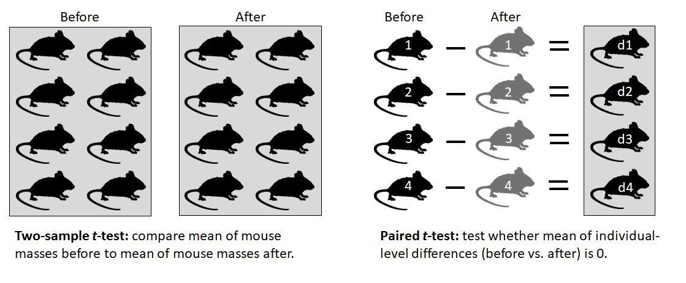
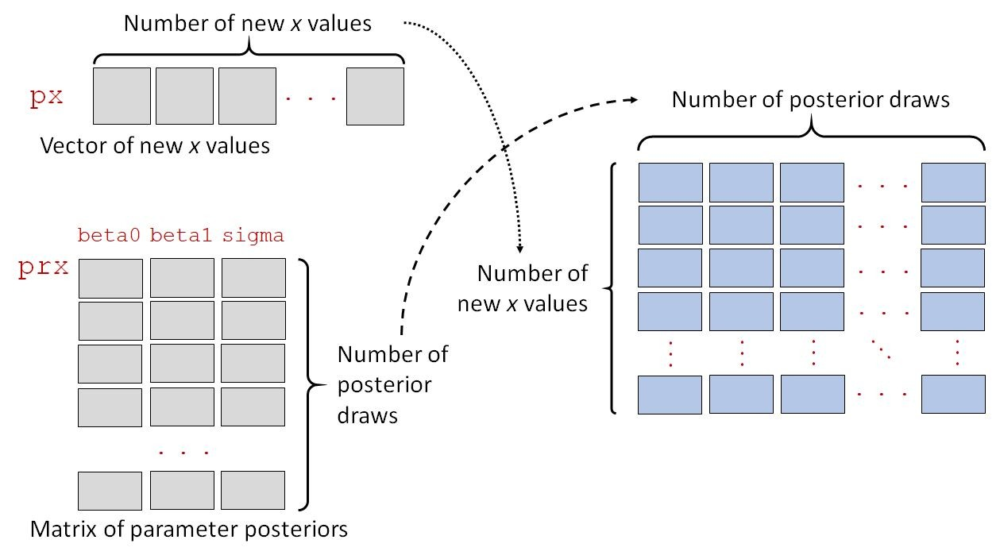
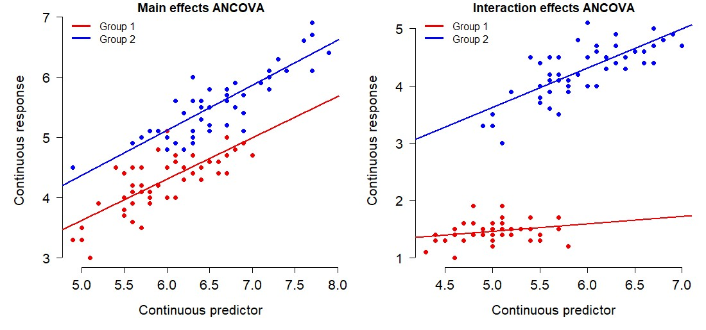

# Linear models, Bayesian style {#sec-linear}

This week we will continue learning the JAGS language and interface by exploring an important class of statistical methods: the linear model. This module includes the following common linear models:

- Student’s *t*-test
- ANOVA
- Linear regression (including multiple linear regression)
- Analysis of covariance (ANCOVA)
- …and probably many more.

In one sense, these are all different “tests” because they test different null hypotheses, use different test statistics, and arrive at their *p*-values differently. However, as we shall see, the distinctions between many of the classic linear models are largely an artifact of the different ways that *p*-values are calculated. In Bayesian inference, where P-values are not used, there is no need to calculate a test statistic. Thus, the Bayesian modeler can look behind the curtain and see that these are really all the same model. So, while “what’s the difference between a *t*-test and ANOVA?” is a good exam question for an introductory (and thus frequentist) statistics course, the question doesn’t even make sense to a Bayesian. In Bayesian inference, this question is like asking about the difference between $3$ and $2+1$. 

**By the end of this module you should be able to:**

1. Specify common linear models in the BUGS/JAGS language.
1. Interpret outputs from JAGS to make inferences about biological systems.

For this module you will need a recent versions of R, JAGS, and the R packages `rjags` and `R2jags` (Plummer 2003, Plummer 2022, R Core Team 2022, Su and Yajima 2021). This module and all code examples were developed and tested using R version 4.2.2, JAGS 4.3.1, `rjags` version 4-13, and `R2jags` version 0.7-1. 

For this module you will need:

```{r}
library(rjags)
library(R2jags)
```

## Linear models refresher  {#sec-linear}

### Enter the matrix  {#sec-linear-matrix}

**Linear models** are called linear models because they assume **linearity**. This means that a change in some response variable $Y$ is described by an additive change in some predictor $X$ multiplied by a constant called the **slope**. The slope encodes the change in in $Y$ resulting from adding 1 to $X$.

$$Y=f\left(X\right)$$

$$f\left(X+1\right)=f\left(X\right)+\beta_1$$

In practice, we also include a *y*-intercept to define the value of the function at $X=0$.

$$f\left(0\right)=\beta_0$$

All linear models can be written very compactly in matrix notation:

$$\bf{Y}=\bf{XB}+\bf{U}$$

The boldface variables indicate that each term is really a matrix, not a variable in the usual sense. In most biological analyses, $\bf{Y}$, $\bf{B}$, and $\bf{U}$ are column vectors, or matrices with 1 column. The matrix $\bf{X}$ is the **design matrix**, which contains the explanatory variables. This notation isn’t very helpful for us biologists, but it describes what the computer is doing when it fits a model. 
The matrix notation above can be expanded as:

$$\left[\begin{matrix}y_1\\y_2\\\vdots\\y_n\\\end{matrix}\right]=\left[\begin{matrix}1&x_{11}&\cdots&x_{1p}\\1&x_{21}&\cdots&x_{2p}\\\vdots&\vdots&\ddots&\vdots\\1&x_{n1}&\cdots&x_{np}\\\end{matrix}\right]\left[\begin{matrix}\beta_0\\\beta_1\\\beta_2\\\vdots\\\beta_p\\\end{matrix}\right]+\left[\begin{matrix}\varepsilon_1\\\varepsilon_2\\\vdots\\\varepsilon_n\\\end{matrix}\right]$$

where $n$ is the number of observations; $y_1$, $y_2$, and so on up to $y_n$ is a column vector of observed values of the dependent variable (aka: response variable); $p$ is the number of model coefficients including the intercept; $x_{ij}$ is the $i$-th value of predictor $j$; $\beta_0$, $\beta_1$, up to $\beta_p$ is the vector of regression coefficients; and $\varepsilon_1$, $\varepsilon_2$, up to $\varepsilon_n$ is a vector of *i.i.d.* normally distributed residuals. This matrix notation illustrates how linear regression can be extended to models with multiple predictor variables or even multiple response variables.

### Straight lines (somehow)

Another meaning of the name “linear” refers to the fact that the change in the response variable $Y$ per unit change in some predictor variable $X$ is a scalar (aka: constant). This means that a given change in $X$ will always produce the same change in $Y$. Changing $X$ from 1 to 2 will have the same effect on $Y$ as changing $X$ from 101 to 102, or 1,000,001 to 1,000,002, which is decidedly not the case with nonlinear functions. In other words, the plot of $Y$ vs. $X$ will be a straight line with a constant slope. If it sounds like I’m belaboring this point, it’s because I am…it’s really important! 

Many models that initially appear nonlinear can nevertheless be analyzed using linear-model methods. The important distinction is not whether the predictors are transformed, but whether the model is linear in its parameters.

For example, a polynomial model

$$Y = \beta_0 + \beta_1X + \beta_2X^2 + \beta_3X^3$$

is still a linear model. Although the relationship between $Y$ and $X$ is curved, the quantities $X^2$ and $X^3$ are simply additional predictor variables once the data are observed. The unknown parameters $\beta_0$, $\beta_1$, $\beta_2$, and $\beta_3$ enter the model only as coefficients.

Similarly, some nonlinear models can be transformed into linear ones. For example, the power law

$$Y = aX^b$$

becomes

$$log\left(Y\right)=log\left(a\right)+blog\left(X\right)$$

after taking logarithms of both sides, producing a linear relationship between $log\left(Y\right)$ and $log\left(X\right)$.

I think of these models as "linear with extra steps." They may require transformed variables or transformed equations, but once those transformations are complete, they can be fit using the same machinery as ordinary linear models.

This notion of linearity is what makes many analyses with factors (categories or grouping variables) as predictors “linear”. For example, the *t*-test is a linear model, but it doesn’t really describe a line on a plot of y vs. x the way that linear regression does. However, if you encode the factor (grouping variable) as 0s and 1s and think about the underlying linear algebra, it becomes clear what the difference in group means really means:

$$
\begin{bmatrix}
y_1\\
y_2\\
\vdots\\
y_n
\end{bmatrix}
=
\begin{bmatrix}
1 & x_1\\
1 & x_2\\
\vdots & \vdots\\
1 & x_n
\end{bmatrix}
\begin{bmatrix}
\beta_0\\
\beta_1
\end{bmatrix}
+
\begin{bmatrix}
\varepsilon_1\\
\varepsilon_2\\
\vdots\\
\varepsilon_n
\end{bmatrix}
$$

For any observation $Y_i$, the expected value (without any error term) is:

$$E\left(y_i\right)=\left(1\times\beta_0\right)+\left(x_i\times\beta_1\right)$$

For group 1, $x_i = 0$, so the expected value is $\beta_0$. For group 2, $x_i = 0$, so the $\beta_1$ term comes into play as the difference in means between groups 1 and 2. This is what R, SAS, and other programs are doing internally when you analyze data with a factor variable.

### Other details and assumptions

Linear models have some other features and assumptions that you need to be aware of. If your data or variables violate the assumptions below, you may need to use something other than linear models to analyze your data. 

#### Normal residuals

A model's **residuals** are the random error, or differences between observed and predicted values. Linear models assume that residuals follow a normal distribution. Models for data that do not have normal residuals exist, but they are not linear models. We’ll explore those in a later module.

The assumption of normal residuals explains the last term in the linear model equation, $\varepsilon_i$:

$$y_i=\beta_0+\beta_1x_i+\varepsilon_i$$

In this equation, $y_i$ is observation $i$ of the response variable $y$; $\beta_0$ is the intercept; $\beta_1$ is the slope; $x_i$ is the predictor variable $x$ for observation $i$, and $\varepsilon_i$ is the residual for observation i ($\varepsilon$ is the Greek letter “epsilon” and usually stands for error or residual terms). The residual term can be expanded like this:

$$y_i=\beta_0+\beta_1x_i+Normal\left(0,\sigma_{res}\right)$$

This expansion makes it clear that each residual $\varepsilon_i$ comes independently from a normal distribution with mean 0 and standard deviation (SD) $\sigma_{res}$. For convenience, we sometimes separate the deterministic part and the stochastic part of the model and write the state space form of the linear regression model:

$$y_i\sim Normal\left(\eta_i,\ \sigma_{res}\right)$$

$$\eta_i=\beta_0+\beta_1x_i$$

In this version, the symbol $\sim $ means “distributed as” and denotes a stochastic relationship—a relationship that contains some element of randomness. This is in contrast to a deterministic relationship, which does not (equality, aka: identity, = is the most famous kind of deterministic relationship).

#### Constant variance (aka: heteroscedasticity)

Linear models assume **homoscedasticity**, or constant variance. This means that the residual variance does not depend on either $x$ or $y$. This is part of the definition of a variable being independent and identically distributed (i.i.d.). If the variance in the response variable depends on some predictor variable, then this should be incorporated into the model (resulting in something other than a linear model). If the variance appears to depend on the response variable, then there is probably an issue with the assumed response distribution (more on this below).

The figure below shows two datasets with a linear relationship between $x$ and $y$. In the left panel, the variance is the same everywhere (homoscedastic). The right panel shows a heteroscedastic relationship where the variance increases at larger $x$.

```{r}
#| echo: false
#| fig.width: 10
#| fig.height: 5


set.seed(123)
n <- 100
x <- runif(n, 0, 20)
y1 <- 1.5 + 1.2 * x + rnorm(n, 0, 3)
y2 <- 1.5 + 1.2 * x + rnorm(n, 0, x/2)

par(mfrow=c(1,2), mar=c(5.1, 5.1, 1.1, 1.1),
    bty="n", lend=1,
    las=1, cex.axis=1.2, cex.lab=1.2)
plot(x, y1, ylim=c(0, 30),
    xlab=expression(italic(x)~variable),
    ylab=expression(italic(y)~variable),
    main="Constant variance")
title(main="aka: homoscedasticity", line=-1, font.main=2)
plot(x, y2, ylim=c(0, 30),
    xlab=expression(italic(x)~variable),
    ylab=expression(italic(y)~variable),
    main="Non-constant variance")
title(main="aka: heteroscedasticity", line=-1, font.main=2)
```

The figure below shows two datasets with a categorical predictor, suitable for a *t*-test. The left panel shows a relationship with equal variances in each group, while the right panel shows a situation with unequal variances.

```{r}
#| echo: false
#| fig.width: 10
#| fig.height: 5

set.seed(321)
n <- 60
dx <- data.frame(x=rep(c("a", "b"), each=n/2))
dx$y1 <- rnorm(n, 5, 2)
dx$y2 <- rnorm(n, 5, 2)
dx$y2[which(dx$x=="b")] <- pmax(0, rnorm(n/2, 20, 8))


par(mfrow=c(1,2), mar=c(5.1, 5.1, 1.1, 1.1),
    bty="n", lend=1,
    las=1, cex.axis=1.2, cex.lab=1.2)
boxplot(y1~x, data=dx, ylim=c(0, 18), 
    xlab="Grouping variable",
    ylab=expression(italic(y)~variable),
    main="Constant variance")
title(main="aka: homoscedasticity", line=-1, font.main=2)
boxplot(y2~x, data=dx, ylim=c(0, 44),
    xlab="Grouping variable",
    ylab=expression(italic(y)~variable),
    main="Non-constant variance")
title(main="aka: heteroscedasticity", line=-1, font.main=2)
```

#### Fixed and independent predictors

Linear models assume that predictor values are precisely known (“fixed”) and independent of each other (i.e., not autocorrelated). If there is uncertainty in the predictor variables, this adds uncertainty to the response values that linear models cannot account for. Simply put, linear models have a term for uncertainty in *y*, $\sigma_{res}$, but no such term for uncertainty in *x*.

#### Independent and identically distributed errors (i.i.d.)

I’ve mentioned this assumption before, but it bears repeating because it is so often violated in biology. The assumption of independently and identically distributed (i.i.d.) errors is ***very*** important. It means that the residual, or predictive error, for each observation depends only on the parameters of the residual distribution and not on predictor variables or other observations. When the assumption of independence is violated, the degrees of freedom in the analysis is artificially inflated because the number of unique pieces of information is smaller than the nominal number of samples. In frequentist analyses, this deflates the P-value and increases the chance of a type I error (false positive). In Bayesian analyses, this tends to reduce the width of the credible intervals and bias parameter estimates. There are methods to deal with errors that are not independent, but linear models are not among them.

## Comparing groups

One common class of analysis is to compare the means, or central tendencies, of groups to each other. In frequentist statistics, this is the realm of the *t*-test and ANOVA. In Bayesian statistics, they are the same thing.

Here we have options:

- Compare the mean of a single set of numbers to a target value: **one-sample *t*-test**.
- Compare the means of two sets of numbers: **two-sample *t*-test**.
- Test whether the differences in paired data are different from 0 (or a target value): **paired *t*-test**.
- Compare the means of two or more sets of numbers: **analysis of variance (ANOVA)**.

### Student's *t*-test

We’ll start with one of the most famous linear models, the Student’s *t*-test. Most people have some vague idea that the *t*-test compares the means of two groups. However, the “*t*-test” is actually a family of tests that evaluate null hypotheses regarding sample means. Some of the most common *t*-tests are shown below:

- One-sample *t*-test, one-tailed: Tests whether population mean of a single set of values is less than, or greater than, a specified values $\mu_0$. Only appropriate in when differences in one direction only are of interest.
- One-sample *t*-test, two-tailed: Tests whether population mean is equal to some specified value $\mu_0$ (null hypothesis) or not (alternative hypothesis).
- Two-sample *t*-test, one-tailed: Tests whether population mean of a one group ($\mu_1$) is less than, or greater than, the mean of another group ($\mu_2$). Only appropriate in when differences in one direction only are of interest.
- Two-sample *t*-test, two-tailed: Tests whether the means in two groups ($\mu_1$ and $\mu_2$) are equal. Can also be thought of testing whether difference in means is equal to 0. Both equal variance (original) and unequal variance (Welch-Satterthwaite) versions exist…biologists should use the unequal variance version.
- Paired *t*-test, one-tailed: Tests whether the mean of differences between paired samples (${\bar{x}}_D=\frac{1}{n}\sum_{i=1}^{n}\left(x_{1,i}-x_{2,i}\right)$) is less than, or greater than, some specified mean difference $D_0$. Only appropriate in when differences in one direction only are of interest.
- Paired *t*-test, one-tailed: Tests whether the mean of differences between paired samples (${\bar{x}}_D=\frac{1}{n}\sum_{i=1}^{n}\left(x_{1,i}-x_{2,i}\right)$) is equal to 0.

These tests share a name because they revolve around the same test-statistic, *t*. The modern version of *t* is the Welch's *t*, which is an improvement over the original Student's *t* that can account for unequal group sizes and group variances:

$$
t =
\frac{\bar{x}_1 - \bar{x}_2}
{\sqrt{\frac{s_1^2}{n_1} + \frac{s_2^2}{n_2}}}
$$

Then the Welch-Satterthwaite equation is used to calculate the appropriate number of degrees of freedom ($\nu$, "nu"):

$$
\nu =
\frac{
\left(
\frac{s_1^2}{n_1} +
\frac{s_2^2}{n_2}
\right)^2
}{
\frac{\left(\frac{s_1^2}{n_1}\right)^2}{n_1-1}
+
\frac{\left(\frac{s_2^2}{n_2}\right)^2}{n_2-1}
}
$$

and then *t* and $\nu$ are used to calculate the *p*-value. In both equations, ${\bar{x}_i}$ is the sample mean of group $i$, $S_i^2$ is the sample variance of group $i$, and $n_i$ is the sample size of group $i$. In a Bayesian analysis, we don't do any of that.

In R, the different *t*-tests are obtained with different arguments to the function `t.test()`. Notice that the outputs have most of the same components; the only real difference is in how the output is interpreted. In particular, notice that the test estimates group means and a confidence interval (CI) for either the group mean or the difference in group means. Our Bayesian models below will also estimate those means and differences, but they will take a more central role.

#### One-sample *t*-test {#sec-linear-onet}

The one sample test compares whether the mean of a set of numbers is significantly different from some target value. By default, that target is 0, but you can specify whatever target you like. Here are some quick examples in R.

```{r}
# generate some data for demonstration
set.seed(123)
a <- rnorm(20, 5, 1)

# one-sample test, two tails
## Is mean of a == 0?
t.test(a)
```

```{r}
# one-sample test, one tail
## Is mean of a > 0?
t.test(a, alternative="greater")
```

```{r}
# one-sample test, one tail
## Is mean of a > 2?
t.test(a, alternative="greater", mu=2)
```

To run a Bayesian one-sample *t*-test, we need to set up our JAGS run as outlined in @sec-jags. Then, write this model to text file and run JAGS. All one-sample *t*-tests are the same model in JAGS. The only difference is in how the credible interval of the mean is interpreted.

```{r}
#| label: fit-onesamplet-jags
#| cache: true

# generate data
set.seed(123)
mu <- 10
sigma <- 3
n <- 20
y <- rnorm(n, mu, sigma)

# means parameterization of one-sample t-test
mod.name <- "jags_ttest_onesample.txt"
sink(mod.name)
cat("
    model{
        # priors
        ## population mean
        mu ~ dnorm(0, 0.001)        

        ## precision and residual SD
        sigma ~ dunif(0.0001, 10)
        tau <- 1/(sigma^2)

        # likelihood
        for(i in 1:n){
            y[i] ~ dnorm(mu, tau)
        }#i

    }#model

", fill=TRUE)
sink()

# parameters to monitor
params <- c("mu", "sigma")

# MCMC parameters
n.iter <- 5e4
n.burnin <- 1e4
n.thin <- 100
nchains <- 3

# function to define initial values for MCMC chains
init.fun <- function(nc){
    res <- vector("list", length=nc)
    for(i in 1:nc){
        res[[i]] <- list(mu=rnorm(1, 0, 100),
                         sigma=runif(1, 0.001, 10))
    }
    return(res)
}
inits <- init.fun(nchains)

# package data for JAGS
in.data <- list(y=y, n=length(y))

mod01 <- jags(data=in.data, inits=inits,
              parameters.to.save=params,
              model.file=mod.name,
              n.chains=nchains, n.iter=n.iter,
              n.burnin=n.burnin, n.thin=n.thin)#jags
mod01
```

The most important output is the mean and 95% CRI for `mu`. If this interval includes the target mean `μ0`, then this is analogous to a non-significant frequentist test and we cannot conclude that `μ` $\neq$ `μ0`. The 95% CRI for `mu` is about `[9.010, 11.846]`. This means, in frequentist terms, that we can conclude that `mu` is not <9.010, and not >11.846. This covers any number of one-tailed tests. Conversely, we cannot conclude that `mu` is different from any `μ0` found within the 95% CRI.

#### Two-sample *t*-test

The two-sample *t*-test is just an extension of the one-sample *t*-test. We just need to include terms for the means, sample sizes, and variances a second group. The data that are generated below have unequal group variances, but the model works just as well with data that have equal variances. The unequal variances model is highly likely to be appropriate in just about any real dataset…so much so that it is the default in R.

```{r}
#| label: fit-twosamplet-jags
#| cache: true

# generate data
set.seed(123)
mu1 <- 10
mu2 <- 15
sigma1 <- 2
sigma2 <- 1
n <- 20
y1 <- rnorm(n, mu1, sigma1)
y2 <- rnorm(n, mu2, sigma2)
y <- c(y1, y2)
x <- rep(1:2, each=n)

# means parameterization of two-sample t-test
mod.name <- "jags_ttest_twosample.txt"
sink(mod.name)
cat("
    model{
        # priors
        ## population means
        for(i in 1:ngroups){
            mu[i] ~ dnorm(0, 0.001)
            sigma[i] ~ dlnorm(1, 0.25)
            tau[i] <- 1/(sigma[i]^2)
        }#i

        # likelihood
        for(i in 1:n){
            y[i] ~ dnorm(mu[x[i]], tau[x[i]])
        }#i

    }#model

", fill=TRUE)
sink()

# parameters to monitor
params <- c("mu", "sigma")

# MCMC parameters
n.iter <- 5e4
n.burnin <- 1e4
n.thin <- 100
nchains <- 3

# function to define initial values for MCMC chains
init.fun <- function(nc){
    res <- vector("list", length=nc)
    for(i in 1:nc){
        res[[i]] <- list(mu=rnorm(2, 0, 100),
                         sigma=runif(2, 0.001, 10))
    }
    return(res)
}
inits <- init.fun(nchains)

# package data for JAGS
in.data <- list(y=y, x=x, n=length(y), ngroups=2)

mod02 <- jags(data=in.data, inits=inits,
              parameters.to.save=params,
              model.file=mod.name,
              n.chains=nchains, n.iter=n.iter,
              n.burnin=n.burnin, n.thin=n.thin)#jags

# inspect results
mod02
```

For a standard two-sample, two-tailed *t*-test, we can compare the 95% CRI of mu[1] and mu[2]: [9.485, 11.223] and [14.571, 15.333]. These CRI do not overlap, so we can conclude that $\mu_1\neq\mu_2$. 

For a two-sample, one-tailed test, we also compare the 95% CRI of `mu[1]` and `mu[2]`. The upper limit of `mu[1]`’s CRI is less than the lower limit of the CRI for `mu[2]`. So, for any number of one-tailed tests we could conclude that $\mu_1<\mu_2$.

If we are unsure whether or not a standard or Welch-Satterthwaite (unequal variances) *t*-test was warranted, we can compare the 95% CRI of `sigma[1]` and `sigma[2]`. These are [1.512, 2.796] and [0.646, 1.222]. Because these CRI do not overlap, we can conclude that groups 1 and 2 had different variances (strictly speaking, they had different SD; you can get the variances and their CRI by squaring the posteriors if that’s what you want).

#### Paired *t*-tests

A paired *t*-test is essentially a one-sample *t*-test on differences between paired samples. For example, mean body weights of individual lab rats before and after some feeding trial.

{#fig-paired-t-test fig-alt="Diagram comparing a two-sample and a paired t-test. The left panel shows independent groups of mice measured before and after treatment, with the two-sample t-test comparing the group means. The right panel shows the same mice measured before and after treatment, with each mouse paired to itself. Individual differences (d1–d4) are calculated for each mouse, and the paired t-test tests whether the mean of these differences equals zero."}

##### Method 1: One sample test on differences

One way to fit a paired *t*-test is to calculate the differences between the paired samples outside of JAGS, then conduct a one-sample *t*-test on the differences. Basically, calculate the differences and feed that difference to the `jags_ttest_onesample` model from @sec-linear-onet as `y`.

##### Method 2: Paired test (direct)

Alternatively, we could code the paired *t*-test as its own model. Instead of fitting group means, we can fit the mean difference directly as `dif` and inspect its posteriors.

```{r}
#| label: fit-pairedt2-jags
#| cache: true

# generate data
set.seed(123)
n <- 20
dif <- 4
y1 <- rnorm(n, 5, 1)
y2 <- y1 + rnorm(n, dif, 0.5)

# means parameterization of paired t-test
mod.name <- "jags_ttest_paired_v1.txt"
sink(mod.name)
cat("
    model{
        # priors
        ## difference in means
        dif ~ dnorm(0, 0.001)

        ## residual SD and precision
        sigma.res ~ dlnorm(1, 0.25)
        tau <- 1/(sigma.res^2)

        # likelihood
        for(i in 1:n){
            y2[i] ~ dnorm(eta[i], tau)
            eta[i] <- y1[i] + dif
        }#i

    }#model

", fill=TRUE)
sink()

# parameters to monitor
params <- c("dif", "sigma.res")

# MCMC parameters
n.iter <- 5e4
n.burnin <- 1e4
n.thin <- 100
nchains <- 3

# function to define initial values for MCMC chains
init.fun <- function(nc){
    res <- vector("list", length=nc)
    for(i in 1:nc){
        res[[i]] <- list(dif=rnorm(1, 0, 100),
                         sigma.res=rlnorm(1, 1, 2))
    }
    return(res)
}
inits <- init.fun(nchains)

# package data for JAGS
in.data <- list(y1=y1, y2=y2, n=n)

mod03 <- jags(data=in.data, inits=inits,
              parameters.to.save=params,
              model.file=mod.name,
              n.chains=nchains, n.iter=n.iter,
              n.burnin=n.burnin, n.thin=n.thin)#jags
mod03

```

The result is spot-on what is estimated by the base R `t.test()` function:

```{r}
t.test(y1, y2, paired=TRUE)
```

### Analysis of variance (ANOVA)

The analysis of variance (ANOVA) is another case of the linear model. It is usually used to compare the means of 3 or more groups. In this way it can be thought of as an extension of the *t*-test from 2 groups to >2, but this is incorrect from a frequentist perspective because of how differently the *t*-test and ANOVA arrive at a *p*-value. It’s better to think of the frequentist *t*-test and ANOVA as cousins. Frequentist ANOVA assesses statistical significance using the statistic *F*, which is related to the amount of variance associated with different sources of variance, relative to the number of degrees of freedom. This is different from t, which is a difference in means scaled by variances and sample sizes, *F*. Either way, *t* and *F* (and all test statistics) are just contrivances to obtain a *p*-value. In Bayesian statistics, we don't need that.

Consider this model:

$$y_i\sim Normal\left(\mu_{x_i},\ \sigma_{res.}\right)$$

If $\mu_{x_i}$ is the mean for the group defined by xi, then what is this model saying? It’s saying that the value of y for observation *i* is drawn from a normal distribution with a mean that depends on group of observation *i*, and some residual variation $\sigma_{res.}$. This single model covers a lot of situations:

- If the number of groups is 1, then this is a one-sample *t*-test
- If the number of groups is 2, then this is a two-sample *t*-test. Or, a one-way ANOVA with two factor levels.
- If the number of groups is 3, then this is a one-way ANOVA with three factor levels.
- If the number of groups is 1, but the values represented paired differences, then this is a paired *t*-test.

All four of these methods, which have different names and different fitting methods in frequentist statistics, are the same model for a Bayesian and can be fit with the same code in JAGS. This kind of generalization is one of the greatest things about Bayesian inference and MCMC model fitting. By getting away from a hyper-fixation on test statistics and *p*-values, we can take a step back and think about what our models really mean. 

#### ANOVA basics

In a typical frequentist ANOVA, one first conducts the omnibus test, which assesses whether any of the group means differ from each other. Then, a post-hoc test is performed to check which groups differ from each other. The code below illustrates this process in R using the built-in `iris` dataset. 

```{r}
# fit the model for anova()
mod1 <- aov(Petal.Length~Species, data=iris)

# omnibus test to get ANOVA table:
summary(mod1)
```

This is the omnibus test result, or “ANOVA table”.The ANOVA table shows us that the factor species uses 2 degrees of freedom (Df or d.f.) to account for 437.10 of the squared errors; the residuals use 147 d.f. to account for 27.22 of the squared errors. The ratio of the mean squared error per d.f. associated with each source, 218.551 / 0.185 = 1180.2, is the test statistic F. The is used to calculate the *p*-value. We can also see that about 94.1% of variation (437.10 / (437.10+27.22)) is associated with species.

However, all the *p*-value in the omnibus test tells us is that the means of at least one pair of species differ. To find out which pair or pairs, we need to use a post-hoc test. My favorite is the Tukey’s honest significant difference (HSD) test because it automatically adjusts for multiple comparisons.

```{r}
# post-hoc test:
TukeyHSD(mod1)
```

This result shows us that all of the species differ from each other. We can see this because all of the *p*-values (`p adj`) for the pairwise comparisons are <0.05 (they are printed by R as 0, but are really just approximated to very tiny value). We can also see this because the 95% CI for the pairwise differences do not include 0. For example, the difference in means for species `versicolor` and `setosa` is 2.798, with 95% CI = [2.59, 3.00]. The value `diff` is literally the mean of `versicolor` minus the mean of `setosa`, as printed on the left of the table.

This is a lot of work. Remember, most of the testing and interpretation in this ANOVA was really just steps taken to get a *p*-value. By using a means parameterization in JAGS, we can get everything in one step in JAGS.


#### One-way ANOVA in JAGS

The previous example with the iris data is an example of one-way ANOVA. The “-way” part just defines how many explanatory factors there are. In the next section we’ll try “two-way” ANOVA, which has 2 factors.

A basic one-way ANOVA model can be fitted in JAGS using essentially the same code as for the two-sample *t*-test (see above). All that we have to adjust are some of the inputs, including `ngroups` (which was 2 for the *t*-test, but can be any positive integer in ANOVA). We’ll use the `iris` dataset as in the previous example


```{r}
#| label: fit-onewayanova-jags
#| cache: true

mod.name <- "jags_anova_oneway.txt"
sink(mod.name)
cat("
    model{
        # priors
        ## population means
        for(i in 1:ngroups){
            mu[i] ~ dnorm(0, 0.001)
            sigma[i] ~ dlnorm(1, 0.25)
            tau[i] <- 1/(sigma[i]^2)
        }#i

        # likelihood
        for(i in 1:n){
            y[i] ~ dnorm(mu[x[i]], tau[x[i]])
        }#i

    }#model

", fill=TRUE)
sink()

# parameters to monitor
params <- c("mu", "sigma")

# MCMC parameters
n.iter <- 5e4
n.burnin <- 1e4
n.thin <- 100
nchains <- 3

# function to define initial values for MCMC chains
init.fun <- function(nc, ngroups=3){
    res <- vector("list", length=nc)
    for(i in 1:nc){
        res[[i]] <- list(mu=rnorm(ngroups, 0, 100),
                         sigma=rlnorm(ngroups, 1, 2))
    }
    return(res)
}
inits <- init.fun(nchains, 3)

# package data for JAGS
xfac <- match(iris$Species, sort(unique(iris$Species)))
ngroups <- max(xfac)
in.data <- list(y=iris$Petal.Length,
    x=xfac, n=nrow(iris), ngroups=ngroups)

mod05 <- jags(data=in.data, inits=inits,
              parameters.to.save=params,
              model.file=mod.name,
              n.chains=nchains, n.iter=n.iter,
              n.burnin=n.burnin, n.thin=n.thin)#jags
mod05
```

Unlike the frequentist ANOVA we performed in R, there is no need for post-hoc test in the Bayesian version of the model. Instead of performing a separate test, we can compare the 95% CRI of the group means directly. For example, species 1 and 2 have different petal lengths because their 95% CRI don’t overlap.

#### Two-way ANOVA in JAGS

In a two-way ANOVA, the variation is partitioned among two potentially explanatory factors—i.e., the variation is split in two ways. There is also three-way ANOVA, four-way ANOVA, and so on. We’ll focus on two-way ANOVA because the code is relatively simple to generalize to other situations.

In base R, we can add more factors to the model with the plus sign `+`.

```{r}
# make a spare copy of iris, and add a variable for color
# (which doesn't explain anything)
iris2 <- iris
iris2$color <- c("red", "white")

# fit the two-way anova
mod2 <- aov(Petal.Length~Species+color,
            data=iris2)
anova(mod2)
```

```{r}
TukeyHSD(mod2)
```

In JAGS, we can get everything in one step. We’ll fit the effects parameterization because it’s easier to define independent effects of species and color this way. Notice that we have to play a little trick in the priors for beta1 and beta2. Technically, the “effect” for the baseline level of a factor should be 0. However, this is not allowed in JAGS because it would have required having some elements of the vectors beta1 and beta2 being deterministic (i.e., `beta1[1] <- 0`), while having other elements of those vectors be stochastic (e.g., `beta1[2] ~ dnorm(0, 0.001)`). This provokes the error message, “`Cannot set value of non-variable node`”.

The solution is to define the prior for the baseline levels to have essentially 0 variance about the true value of 0. We used a normal with $\mu=0$ and $\sigma^2=0.000000001$. Another way to look at this is that we place a very strong prior on this parameter, so strong that no amount of data would be sufficient to update it.

```{r}
#| label: fit-twowayanova-jags
#| cache: true

iris2 <- iris
iris2$color <- c("red", "white")

# effects parameterization of two-way ANOVA
# without interaction (main effects)
mod.name <- "jags_anova2way_main.txt"
sink(mod.name)
cat("
    model{
        # priors
        ## intercept
        beta0 ~ dnorm(0, 0.001)

        ## effects of factor 1
        beta1[1] ~ dnorm(0, 1e9) # set first level to 0
        beta1[2] ~ dnorm(0, 0.001)
        beta1[3] ~ dnorm(0, 0.001)

        ## effects of factor 2
        beta2[1] ~ dnorm(0, 1e9) # set first level to 0
        beta2[2] ~ dnorm(0, 0.001)

        ## residual SD and precision
        sigma ~ dlnorm(1, 0.25)
        tau <- 1 / (sigma^2)

        # likelihood
        for(i in 1:n){
            y[i] ~ dnorm(eta[i], tau)
            eta[i] <- beta0 + beta1[fac1[i]] + beta2[fac2[i]]
        }#i

    }#model

", fill=TRUE)
sink()

# parameters to monitor
params <- c("beta0", "beta1", "beta2", "sigma")

# MCMC parameters
n.iter <- 5e4
n.burnin <- 1e4
n.thin <- 100
nchains <- 3

# reformat data for JAGS
fac1 <- match(iris2$Species, sort(unique(iris2$Species)))
nfac1 <- max(fac1)
fac2 <- match(iris2$color, sort(unique(iris2$color)))
nfac2 <- max(fac2)

# package data for JAGS
in.data <- list(y=iris2$Petal.Length,
    n=nrow(iris2),
    fac1=fac1, fac2=fac2)

# function to define initial values for MCMC chains
init.fun <- function(nc){
    res <- vector("list", length=nc)
    for(i in 1:nc){
        res[[i]] <- list(beta0=rnorm(1, 0, 100),
                         beta1=c(0, rnorm(nfac1-1, 0, 100)),
                         beta2=c(0, rnorm(nfac2-1, 0, 100)),
                         sigma=rlnorm(1, 1, 2))
    }
    return(res)
}
inits <- init.fun(nchains)

# fit model
mod06 <- jags(data=in.data, inits=inits,
              parameters.to.save=params,
              model.file=mod.name,
              n.chains=nchains, n.iter=n.iter,
              n.burnin=n.burnin, n.thin=n.thin)#jags
mod06
```

The output tells us that the effect of being in level 2 of species (`versicolor`) instead of level 1 (`setosa`) is to have a petals about 2.799 cm longer, with 95% CRI approximately [2.614, 2.967] (numbers may differ a bit because of the random sampling at render time). Likewise, the effect of being `white` instead of `red` (color 2 instead of color 1) is -0.039, with 95% CRI = [-0.182, 0.095]. As always, whether or not the 95% CRI includes 0 gives us an indication of whether or not that factor differs significantly from the baseline...analogous to the main effect P-value in a frequentist analysis.

#### Two-way ANOVA with interaction

Interestingly, fitting a two-way ANOVA with an interaction term is easier than fitting the model without interactions. Easier, that is, so long as you understand JAGS syntax. We’re going to use the bracket notation for subsetting objects. This notation works the same way in JAGS as it works in R. In a nutshell:

- For some vector `x`, `x[a]` is the `a`-th element of `x`. So `x[1]` is first, `x[3]` is third, and so on.
- For some matrix `z`, `z[a,b]` is the element in row `a`, column `b`. So, `z[1,3]` is in row `1`, column `3`. A blank index selects all elements of that dimension: `z[,2]` selects all elements of column `2`, while `x[4,]` selects all elements from row `4`. Depending on the context, selecting an entire row or column like this may return a vector instead of a matrix. 
- A matrix with $>2$ dimensions is called an **array**, and the bracket notation extends to arrays of any dimension . So, `a[j,k,l]` is the value in row `j`, column `k`, and layer `l` of array `a`. A blank index selects all elements of a dimension.

:::{callout-tip}
**It's all arrays**

Technically, an array is any ordered arrangement of elements. Vectors are 1-dimensional arrays (length), matrices are 2-dimensional arrays (rows and columns), and anything with >2 layers is usually just called an array. There is no technical name for the third or higher dimensions of an array, but "layer" makes sense for the third dimension of a 3d array.
:::

Clever use of high-dimensional arrays can simplify the programming of some very complex models...we’ll see some examples later in the semester .

Let’s set up a data frame with an interaction.

```{r}
set.seed(123)
n <- 20
dx <- expand.grid(species=1:3,
    loc=1:2, ind=1:n)
dx$y <- NA

n <- nrow(dx)
nspp <- 3
nloc <- 2

# "true" means with interaction between spp and loc
mu <- matrix(c(15, 30, 45, 25, 30, 15),
    nrow=nspp, ncol=nloc,
    dimnames=list(
        paste0("spp", 1:nspp),
        paste("loc", 1:nloc)))

# residual SD
sigma.res <- 5

# draw y values given interaction and SD
for(i in 1:n){
    dx$y[i] <- rnorm(1, mu[dx$species[i], dx$loc[i]], sigma.res)
}

# quick check:
boxplot(y~loc+species, data=dx)
```

The boxplot shows us what the interaction does. The effect of one factor depends on the effect of another factor. Here, the effect of location is different for each species: 

- Location 2 has greater values than location 1 for species 1, smaller values than location 1 for species 3, and the same values as location 1 for species 2.
- In location 1, species 1 has the smallest values and species 3 has the greatest values. In location 2, species 3 has the smallest values and species 2 has the greatest values.

Another way to visualize this is with an **interaction plot**. This shows the group means across every combination of factor levels. When lines are parallel (or do not cross), then there is probably no interaction. However, if lines do cross, then there is likely an interaction and you need to test for it.


```{r}
par(mfrow=c(1,2), bty="n")
interaction.plot(dx$loc, dx$species, dx$y)
interaction.plot(dx$species, dx$loc, dx$y)
```

We can fit a Bayesian ANOVA with interaction by using the means parameterization of the model. This model can also be used to fit ANOVA without interaction as well. Just as with some of the *t*-tests above, different readings of the model outputs can lead to different versions of the test.

```{r}

#| label: fit-twowayanovainter-jags
#| cache: true

set.seed(123)
n <- 20
dx <- expand.grid(species=1:3,
    loc=1:2, ind=1:n)
dx$y <- NA

n <- nrow(dx)
nspp <- 3
nloc <- 2

# "true" means with interaction between spp and loc
mu <- matrix(c(15, 30, 45, 25, 30, 15),
    nrow=nspp, ncol=nloc,
    dimnames=list(
        paste0("spp", 1:nspp),
        paste("loc", 1:nloc)))

# residual SD
sigma.res <- 5

# draw y values given interaction and SD
for(i in 1:n){
    dx$y[i] <- rnorm(1, mu[dx$species[i], dx$loc[i]], sigma.res)
}

# means parameterization of two-way ANOVA
# with interaction (works for without also)
mod.name <- "jags_anova2way_means.txt"
sink(mod.name)
cat("
    model{
        # priors
        for(i in 1:nfac1){
            for(j in 1:nfac2){
                mu[i,j] ~ dnorm(0, 0.001)
            }#j
        }#i

        ## residual SD and precision
        sigma ~ dlnorm(1, 0.25)
        tau <- 1 / (sigma^2)

        # likelihood
        for(i in 1:n){
            y[i] ~ dnorm(mu[fac1[i], fac2[i]], tau)
        }#i

    }#model

", fill=TRUE)
sink()

# parameters to monitor
params <- c("mu", "sigma")

# MCMC parameters
n.iter <- 5e4
n.burnin <- 1e4
n.thin <- 100
nchains <- 3

# reformat data for JAGS
fac1 <- dx$species
nfac1 <- max(fac1)
fac2 <- dx$loc
nfac2 <- max(fac2)

# package data for JAGS
in.data <- list(y=dx$y,
    n=n,
    fac1=fac1, fac2=fac2,
    nfac1=nfac1, nfac2=nfac2)

# function to define initial values for MCMC chains
init.fun <- function(nc){
    res <- vector("list", length=nc)
    for(i in 1:nc){
        res[[i]] <- list(mu=matrix(rnorm(nfac1*nfac2, 0, 100),
                             nrow=nfac1, ncol=nfac2),
                         sigma=rlnorm(1, 1, 2))
    }
    return(res)
}
inits <- init.fun(nchains)

# fit model
mod07 <- jags(data=in.data, inits=inits,
              parameters.to.save=params,
              model.file=mod.name,
              n.chains=nchains, n.iter=n.iter,
              n.burnin=n.burnin, n.thin=n.thin)#jags
mod07
```

We can inspect the posteriors to see how the means differed among the 6 combinations of factor levels: species 1, location 1 (mu[1,1]); species 1, location 2 (mu[1,2]); and so on. Doing so would lead us to discover the same interaction we suspected based on the interaction plot above. A better way might be to visualize the group means using the posteriors. Below is one way to do it:

```{r}
# get means and 95% CRI for plot
res <- mod07$BUGSoutput$summary
res1 <- res[2:4, c(1, 3, 7)]
res2 <- res[5:7, c(1, 3, 7)]

par(mfrow=c(1,1), mar=c(5.1, 8.1, 1.1, 1.1))
plot(1:2, type="n", xlim=c(10, 50),
    ylim=c(0, 3.5), xlab="Posterior",
    yaxt="n", ylab="")
segments(res1[,2], 1:3, res1[,3], 1:3, lwd=3)
segments(res2[,2], 1:3+0.2, res2[,3], 1:3+0.2, lwd=3, col="red")
points(res1[,1], 1:3, pch=16, cex=1.2)
points(res2[,1], 1:3+0.2, pch=16, cex=1.2, col="red")
legend("bottomright", legend=paste("Location", 1:2),
    pch=16, col=c("black", "red"), cex=1.2, bty="n")
axis(side=2, at=1:3+0.1, labels=paste("Species", 1:3), las=1)
segments(10, 1:3+0.1, 50, 1:3+0.1, lty=2)
```


## Continuous patterns

### Linear regression

One of the most well-known of all statistical analyses, the linear regression model describes a pattern where some response variable $y$ varies as a linear function of a predictor variable $x$. The equation is:


$$y=\beta_0+\beta_1x+\varepsilon$$

where:
- $y$ is the response or dependent variable
- $x$ is the explanatory, predictor, or independent variable
- $\beta_0$ is the *y*-intercept (i.e., the value of $y$ when $x = 0$) (“beta zero” or “beta naught”)
- $\beta_1$ is the slope or regression coefficient (i.e., the change in $y$ per unit change in $x$) (“beta one”). If $x$ increases by 1, then y increases by $\beta_1$.
- $\varepsilon$ is a random error term that describes residual variation not explained by the model (“epsilon”). 

When we specify the model in JAGS, we do so using an observation-wise, state-space notation.

$$y_i~Normal\left(\eta_i,\ \sigma_{res}\right)$$

$$\eta_i=\beta_0+\beta_1x_i$$

This format makes it clear that each y value has its own expected value $\eta_i$ (“eta sub i"), dependent on that observation’s $x$ value $x_i$. This relates to a key assumption of the linear model, that residuals are independently and identically distributed (i.i.d.). It also echoes the way we program the model likelihood in JAGS, a for loop.

The “state-space” part of the formulation above refers to the fact that the model equation explicitly spearates the true, unobserved, “state” of the system from the observed values which occur in a “space” defined by the state and the uncertainty about the observation process.

#### Linear regression in JAGS

The procedure for linear regression in JAGS is very similar to the procedure for the effects parameterization of the two-way ANOVA that we saw in section X. As we’ll soon see, this is also very similar to how we’ll fit a wide variety of models for the rest of the course—linear or otherwise.

```{r}
#| label: fit-linreg-jags
#| cache: true

library(rjags)
library(R2jags)
# simulate some data
set.seed(42)
n <- 50
dx <- data.frame(x=runif(n, 0, 20))

beta0 <- 4
beta1 <- 1.8
sigma.res <- 4
dx$y <- beta0 + beta1*dx$x + rnorm(n, 0, sigma.res)

# linear regression with 1 predictor
mod.name <- "jags_linreg_1x.txt"
sink(mod.name)
cat("
    model{
        # priors
        ## intercept
        beta0 ~ dnorm(0, 0.001)

        ## slope
        beta1 ~ dnorm(0, 0.001)

        ## residual SD and precision
        sigma ~ dlnorm(1, 0.25)
        tau <- 1 / (sigma^2)

        # likelihood
        # (for loop)
        for(i in 1:n){
            y[i] ~ dnorm(eta[i], tau)
            eta[i] <- beta0 + beta1 * x[i]
        }#i

    }#model

", fill=TRUE)
sink()

# parameters to monitor
params <- c("beta0", "beta1", "sigma")

# MCMC parameters
n.iter <- 5e4
n.burnin <- 1e4
n.thin <- 100
nchains <- 3

# package data for JAGS
in.data <- list(y=dx$y,
    n=n, x=dx$x)

# function to define initial values for MCMC chains
init.fun <- function(nc){
    res <- vector("list", length=nc)
    for(i in 1:nc){
        res[[i]] <- list(beta0=rnorm(1, 0, 100),
                         beta1=rnorm(1, 0, 100),
                         sigma=rlnorm(1, 1, 2))
    }
    return(res)
}
inits <- init.fun(nchains)

# fit model
mod08 <- jags(data=in.data, inits=inits,
              parameters.to.save=params,
              model.file=mod.name,
              n.chains=nchains, n.iter=n.iter,
              n.burnin=n.burnin, n.thin=n.thin)#jags
mod08
```

The outputs show that the posterior means for beta0 and beta1 are reasonably close to the truth (3.843 vs. 4, and 1.791 vs. 1.8) and the estimates from the frequentist model fit in R. The true values are well within the 95% CRI. 

The next step is to produce a plot of the model’s predicted values and 95% CRI. As we’ll see, this is a little more involved than the process in R. But, we’ll practice the process so much that it will seem easy by the end of the course!

#### Plotting model predictions in R

The basic procedure for plotting a linear model and its predictions in R is as follows:
1. Fit the model and save it to a model object.
1. Generate predicted values and SE of predicted values over a range of x values that cover the range of observed x.
1. Use the predicted values and SE to calculate 95% confidence intervals (CI) of the predictions.
1. Plot the predictions and 95% CI.

Here is what that looks like:

```{r}
# fit the model
mod08fr <- lm(y~x, data=dx)

# new data for prediction
px <- seq(min(dx$x), max(dx$x), length=100)

# prediction with expected mean and SE of Y
pred <- predict(mod08fr, newdata=data.frame(x=px),
                se.fit=TRUE, interval="confidence")

# predicted mean and 95% CI
y.lo <- pred$fit[,2]
y.mn <- pred$fit[,1]
y.up <- pred$fit[,3]

# fancy plot options with par()
par(mfrow=c(1,1), mar=c(5.1, 5.1, 1.1, 1.1),
    bty="n", lend=1,
    las=1, cex.axis=1.2, cex.lab=1.2)
# make the plot and set basic options
plot(dx$x, dx$y, type="n",
    ylim=c(0, 50), xlim=c(0, 20),
    xlab="x variable", ylab="y variable")
# add lines for lower, upper conf. limits
# and predicted mean
points(px, y.lo, type="l", lwd=2, lty=2) 
points(px, y.up, type="l", lwd=2, lty=2) 
points(px, y.mn, type="l", lwd=2)
# put original data on top, so not covered by 
# lines and etc.
points(dx$x, dx$y, pch=16, cex=1.2)
```

We will have to perform the same basic steps to produce a similar plot from JAGS, but the implementation is a bit different because there isn’t a good `predict()` method in R for these kinds of models . 

We are going to use the posterior draws for each parameter. To avoid issues with autocorrelation in the chains, we will pull these from `sims.matrix` instead of `sims.array`. These values have been permuted from the raw MCMC outputs so that predicted values do not suffer from any potential issues of autocorrelation in the chains or cross-correlations between the posteriors of different parameters.

```{r}
# matrix of coefficients
prx <- mod08$BUGSoutput$sims.matrix
## don't need deviance or sigma
prx <- prx[,c("beta0", "beta1")]
post.n <- nrow(prx)
```

Next, we need a vector of x values at which to predict using the model. As before, we’ll set up a series of values at small intervals over the full range of observed x.

```{r}
# x values at which to predict
pred.n <- 100
px <- seq(min(dx$x), max(dx$x), length=pred.n)
```

If you are familiar with matrix multiplication, the matrix of predictions can be obtained very quickly by constructing the design matrix and multiplying it by the transpose of the coefficients matrix:

```{r}
design.mat <- matrix(c(rep(1, pred.n), px), ncol=2)
pred.mat <- design.mat %*% t(prx)
```

In my experience, the easier and more flexible approach is to calculate the predicted values in a loop (the above only works with ordinary linear models). Set up a matrix to hold the predicted values for each posterior draw of the predictors, and for each value of the predictor variable at which we want a prediction. This part is a bit tricky, so consider the figure below. The plan here is to end up with the predictor values along one margin (rows) and the replicates along the other (columns) . Once the matrix is filled, we can use `apply()` to get quantiles of the predicted values for each x. 

{#fig-linearpredict fig-alt="Figure showing the relationship between the objects used to calculate the predicted values from a linear regression from the matrix of posterior draws of each parameter in sims.array, a vector px of new x values, and a data frame prx that contains predictors and model parameters across model posteriors."}

```{r}
# set up matrix
pred.mat <- matrix(NA, nrow=pred.n, ncol=post.n)

# fill in a loop
for(i in 1:post.n){
    pred.mat[,i] <- prx[i,"beta0"] + prx[i,"beta1"] * px
}#i
```

No matter how the predicted values for every new x were calculated, we can get the mean and 95% CRI using the mean and quantile functions. Sometimes I’ll use the posterior median instead of the mean. For linear models it doesn’t matter, but for models with other response distributions the median can be more representative of the central tendency.

```{r}
# set up data frame with mean and CRI
plotdf <- data.frame(x=px,
    mn=apply(pred.mat, 1, mean),
    lo=apply(pred.mat, 1, quantile, 0.025),
    up=apply(pred.mat, 1, quantile, 0.975))
```

We can use our new object `plotdf` to make a nice plot of the model predictions. The code is almost identical to the code for the frequentist model outputs shown above because we set up the objects containing the plot values in the same way.

```{r}
# fancy plot options with par()
par(mfrow=c(1,1), mar=c(5.1, 5.1, 1.1, 1.1),
    bty="n", lend=1,
    las=1, cex.axis=1.2, cex.lab=1.2)
# make the plot and set basic options
plot(dx$x, dx$y, type="n",
    ylim=c(0, 50), xlim=c(0, 20),
    xlab="x variable", ylab="y variable")
# add lines for lower, upper conf. limits
# and predicted mean
points(plotdf$x, plotdf$lo, type="l", lwd=2, lty=2) 
points(plotdf$x, plotdf$up, type="l", lwd=2, lty=2) 
points(plotdf$x, plotdf$mn, type="l", lwd=2)
# put original data on top, so not covered by 
# lines and etc.
points(dx$x, dx$y, pch=16, cex=1.2)
```

If you add the frequentist predictions and CI with the following commands, you’ll see that they are nearly the same as the Bayesian prediction and CRI.

```{r}
# fancy plot options with par()
par(mfrow=c(1,1), mar=c(5.1, 5.1, 1.1, 1.1),
    bty="n", lend=1,
    las=1, cex.axis=1.2, cex.lab=1.2)
# make the plot and set basic options
plot(dx$x, dx$y, type="n",
    ylim=c(0, 50), xlim=c(0, 20),
    xlab="x variable", ylab="y variable")
# add lines for lower, upper conf. limits
# and predicted mean
points(plotdf$x, plotdf$lo, type="l", lwd=2, lty=2) 
points(plotdf$x, plotdf$up, type="l", lwd=2, lty=2) 
points(plotdf$x, plotdf$mn, type="l", lwd=2)
# put original data on top, so not covered by 
# lines and etc.
points(dx$x, dx$y, pch=16, cex=1.2)
# add frequentist interval for comparison
points(px, y.lo, type="l", lwd=2, lty=2, col="red") 
points(px, y.up, type="l", lwd=2, lty=2, col="red") 
points(px, y.mn, type="l", lwd=2, col="red")
legend("topleft", legend=c("Frequentist", "Bayesian"),
    lwd=3, col=c("red", "black"))
```

### Multiple linear regression

In multiple linear regression, or multiple regression, $Y$ is predicted by more than one $X$ variable. The $X$ variables are assuemed to be orthogonal, or uncorrelated, with each other. If predictors are correlated, it may be difficult to accurately partition sums of squares between them and get a precise estimate of each one's effect. This problem is also called model **identifiability**. 

Adding additional variables to a regression in JAGS is straightforward; it just requires a little more bookkeeping than in R.

```{r}
#| label: fit-multiplereg-jags
#| cache: true

# simulate some data
set.seed(42)
n <- 100
dx <- data.frame(x1=runif(n, 0, 20),
    x2=runif(n, 0, 20))

beta0 <- 4
beta1 <- 1.8
beta2 <- -2.1
sigma.res <- 4
dx$y <- beta0 + beta1*dx$x1 + beta2*dx$x2 +
    rnorm(n, 0, sigma.res)

# linear regression with 2 predictors
mod.name <- "jags_linreg_2x.txt"
sink(mod.name)
cat("
    model{
        # priors
        ## intercept
        beta0 ~ dnorm(0, 0.001)

        ## slopes
        beta1 ~ dnorm(0, 0.001)
        beta2 ~ dnorm(0, 0.001)

        ## residual SD and precision
        sigma ~ dlnorm(1, 0.25)
        tau <- 1 / (sigma^2)

        # likelihood
        for(i in 1:n){
            y[i] ~ dnorm(eta[i], tau)
            eta[i] <- beta0 + beta1 * x1[i] + beta2 * x2[i]
        }#i

    }#model

", fill=TRUE)
sink()

# parameters to monitor
params <- c("beta0", "beta1", "beta2", "sigma")

# MCMC parameters
n.iter <- 5e4
n.burnin <- 1e4
n.thin <- 100
nchains <- 3

# package data for JAGS
in.data <- list(y=dx$y,
    n=n, x1=dx$x1, x2=dx$x2)

# function to define initial values for MCMC chains
init.fun <- function(nc){
    res <- vector("list", length=nc)
    for(i in 1:nc){
        res[[i]] <- list(beta0=rnorm(1, 0, 100),
                         beta1=rnorm(1, 0, 100),
                         beta2=rnorm(1, 0, 100),
                         sigma=rlnorm(1, 1, 2))
    }
    return(res)
}
inits <- init.fun(nchains)

# fit model
mod09 <- jags(data=in.data, inits=inits,
              parameters.to.save=params,
              model.file=mod.name,
              n.chains=nchains, n.iter=n.iter,
              n.burnin=n.burnin, n.thin=n.thin)#jags
mod09
```

####Plotting predicted values from multiple regression

Getting predicted values is also straightforward. The biggest change from the model with one predictor is that we need to generate two sets of predictions:

- Predict over range of `x1` while holding `x2` at its median
- Predict over range of `x2` while holding `x1` at its median

Because the effects of `x1` and `x2` are independent of each other (at least, they are assumed to be), these two sets of predictions will allow us to see the effects of each variable while holding the other constant at a “typical” value. In your write-up, you should state explicitly that this is how you generated predictions.

```{r}
# matrix of coefficients
prx <- mod09$BUGSoutput$sims.matrix
## don't need deviance or sigma
prx <- prx[,c("beta0", "beta1", "beta2")]

# x values at which to predict
pred.n <- 100
px1 <- seq(min(dx$x1), max(dx$x1), length=pred.n)
px2 <- seq(min(dx$x2), max(dx$x2), length=pred.n)

# set up matrices for predictions
pred2 <- pred1 <- matrix(NA, nrow=pred.n, ncol=post.n)

# fill in a loop
for(i in 1:post.n){
    pred1[,i] <- prx[i,"beta0"] +
        prx[i,"beta1"] * px1 +
        prx[i,"beta2"] * median(dx$x2)
    pred2[,i] <- prx[i,"beta0"] +
        prx[i,"beta1"] * median(dx$x1) +
        prx[i,"beta2"] * px2
}#i

pr1 <- data.frame(x1=px1, 
    mn=apply(pred1, 1, mean),
    lo=apply(pred1, 1, quantile, 0.025),
    up=apply(pred1, 1, quantile, 0.975))

pr2 <- data.frame(x2=px2, 
    mn=apply(pred2, 1, mean),
    lo=apply(pred2, 1, quantile, 0.025),
    up=apply(pred2, 1, quantile, 0.975))

# fancy plot options with par()
par(mfrow=c(1,2), mar=c(5.1, 5.1, 1.1, 1.1),
    bty="n", lend=1,
    las=1, cex.axis=1.2, cex.lab=1.2)
# x1 plot
plot(dx$x1, dx$y, type="n",
    ylim=c(-40, 40), xlim=c(0, 20),
    xlab="x1", ylab="y variable")
points(pr1$x1, pr1$lo, type="l", lwd=2, lty=2) 
points(pr1$x1, pr1$up, type="l", lwd=2, lty=2) 
points(pr1$x1, pr1$mn, type="l", lwd=2)
# put original data on top, so not covered by 
# lines and etc.
points(dx$x1, dx$y, pch=16)

# x2 plot
plot(dx$x2, dx$y, type="n",
    ylim=c(-40, 40), xlim=c(0, 20),
    xlab="x2", ylab="y variable")
points(pr2$x2, pr2$lo, type="l", lwd=2, lty=2) 
points(pr2$x2, pr2$up, type="l", lwd=2, lty=2) 
points(pr2$x2, pr2$mn, type="l", lwd=2)
# put original data on top, so not covered by 
# lines and etc.
points(dx$x2, dx$y, pch=16)
```

## Analysis of covariance (ANCOVA)

In **analysis of covariance (ANCOVA)**, a continuous response variable is modeled using a continuous explanatory variable and a factor (grouping variable). You’ve probably heard of ANCOVA before without realizing it. When scientific studies are described on the news, the reporter might say that the researchers “controlled for” the effects of additional variables. That often means that the researchers used a type of ANCOVA in their analysis.

The figure below shows two examples of what ANCOVA looks like in practice. Both types of ANCOVA are extremely common in biology, so we’ll fit both (although, as we’ll see, they can be the same model in JAGS).

{#fig-ancova fig-cap="Left: ANCOVA with main effects only, where group membership (a factor variable) affects the intercept of the relationship between Y and X. Right: ANCOVA with interaction effects, where group membership can affect the intercept and the slope (effect of X on Y)."}

- Left: y increases as a linear function of x, and values in group 2 tend to be larger than values in group 1. Groups 1 and 2 share the same slope, so x has the same effect on y in both groups.
- Right: y varies as a function of x, and the effect of x on y is different in each group (i.e., the slopes are different). This is “interaction effects” ANCOVA, or “ANCOVA with interaction”. An “interaction” means that the effect of one variable affects the effect of another variable.

###### figure

### ANCOVA with main effects only
As always, we’ll simulate a dataset and then analyze it. Before that we need to think about how we want to write the ANCOVA model. The traditional way is the effects parameterization:

$$y_i=Normal\left(\eta_i,\sigma_{res}\right)$$

$$\eta_i=\beta_0+\beta_1{x1}_i+\beta_2{x2}_i$$

where x1 is the continuous predictor variable, and x2 is a variable (or matrix of dummy variables) that describes group membership (i.e., levels of the factor). This model has an intercept ($\beta_0$) and a term that describes group effects ($\beta_0$). The downside of writing the model this way is in how effects are represented: as differences from the baseline level. This can be confusing to add up.

Grouping the factor effects and the intercept gives us something more like a means parameterization of ANCOVA:

$$y_i=Normal\left(\eta_i,\sigma_{res}\right)$$

$$\eta_i=\beta_{0,{fac}_i}+\beta_1{x1}_i$$

Here the $\beta_2$ term is combined with the intercept, such that the intercept varies between groups: $\beta_{0,{fac}_i}$. This version of the model avoids the awkwardness of having to add parameters together to see what the values in each group should be.

The means parameterization of ANCOVA is easier to deal with in JAGS than the effects parameterization, and is easy to extend to other situations, including mixed models.


```{r}
#| label: fit-ancovamain-jags
#| cache: true

# simulate some data
set.seed(123)
n <- 50
nfac <- 3
dx <- data.frame(x1=runif(n*nfac, 0, 20),
    fac1=rep(1:nfac, each=n))

beta0 <- c(-10, 0, 10)
beta1 <- 1.8
sigma.res <- 3
dx$y <- beta0[dx$fac1] + beta1*dx$x1 +
    rnorm(nrow(dx), 0, sigma.res)

dx$col <- rainbow(3)[dx$fac1]
plot(dx$x1, dx$y, col=dx$col)
summary(lm(y~x1+factor(fac1), data=dx))

# linear regression with 2 predictors
mod.name <- "jags_ancova_main_1x1f.txt"
sink(mod.name)
cat("
    model{
        # priors
        ## intercept
        for(i in 1:nfac1){
            beta0[i] ~ dnorm(0, 0.001)
        }#i

        ## slope
        beta1 ~ dnorm(0, 0.001)

        ## residual SD and precision
        sigma ~ dlnorm(1, 0.25)
        tau <- 1 / (sigma^2)

        # likelihood
        for(i in 1:n){
            y[i] ~ dnorm(eta[i], tau)
            eta[i] <- beta0[fac1[i]] + beta1 * x1[i]
        }#i

    }#model

", fill=TRUE)
sink()

# parameters to monitor
params <- c("beta0", "beta1", "sigma")

# MCMC parameters
n.iter <- 5e4
n.burnin <- 1e4
n.thin <- 100
nchains <- 3

# package data for JAGS
in.data <- list(y=dx$y, n=nrow(dx),
    x1=dx$x1,
    fac1=dx$fac1, nfac1=nfac)


# function to define initial values for MCMC chains
init.fun <- function(nc){
    res <- vector("list", length=nc)
    for(i in 1:nc){
        res[[i]] <- list(beta0=rnorm(nfac, 0, 100),
                         beta1=rnorm(1, 0, 100),
                         sigma=rlnorm(1, 1, 2))
    }
    return(res)
}
inits <- init.fun(nchains)

# fit model
mod10 <- jags(data=in.data, inits=inits,
              parameters.to.save=params,
              model.file=mod.name,
              n.chains=nchains, n.iter=n.iter,
              n.burnin=n.burnin, n.thin=n.thin)#jags
mod10
```

The estimated slope and group-level means are basically correct, up to sampling error. 

#### Plotting ANCOVA with main effects only

Making a plot with predictions and their 95% CRI is similar to what we did for multiple linear regression. We need to generate predictions within each group of the factor `fac1` using the group-specific parameters, and present the groups with different colors, symbols, line styles, etc. 

```{r}
# matrix of coefficients
prx <- mod10$BUGSoutput$sims.matrix
## don't need deviance or sigma
prx <- prx[,grep("beta", colnames(prx))]

# x values at which to predict
pred.n <- 100
px <- seq(min(dx$x1), max(dx$x1), length=pred.n)

# set up matrices for predictions
# one for each group (level of fac1)
preddf <- expand.grid(x1=px, fac1=1:nfac)
npred <- nrow(preddf)

pred <- matrix(NA, nrow=nrow(preddf), ncol=post.n)

# fill in a loop
for(i in 1:post.n){
    pred[,i] <- prx[i,preddf$fac1] +
        prx[i,"beta1"] * preddf$x1
}#i

# apply to get mean and CRI
preddf$mn <- apply(pred, 1, mean)
preddf$lo <- apply(pred, 1, quantile, 0.025)
preddf$up <- apply(pred, 1, quantile, 0.975)

# define some colors and shapes:
cols <- rainbow(nfac)
pchs <- 15:17 # square, circle, triangle

# fancy plot options with par()
par(mfrow=c(1,1), mar=c(5.1, 5.1, 1.1, 1.1),
    bty="n", lend=1,
    las=1, cex.axis=1.2, cex.lab=1.2)
# x1 plot
plot(dx$x1, dx$y, type="n",
    ylim=c(-10, 50), xlim=c(0, 20),
    xlab="x1", ylab="y")
for(i in 1:nfac){
    flag <- which(preddf$fac1==i)
    points(px, preddf$mn[flag], type="l",
        lwd=3, col=cols[i])
    points(px, preddf$lo[flag], type="l",
        lwd=3, lty=2, col=cols[i])
    points(px, preddf$up[flag], type="l",
        lwd=3, lty=2, col=cols[i])
}#i
# put original data on top, so not covered by 
# lines and etc.
points(dx$x1, dx$y, pch=pchs[dx$fac1], col=cols[dx$fac1])
legend("topleft", legend=paste("Group", 1:nfac),
       pch=pchs, col=cols, cex=1.2)
```


### ANCOVA with interaction

The ANCOVA with interaction effect model will be constructed by combining bits of the main effects ANCOVA model with the “parameters as arrays” trick we learned in the ANOVA with interaction model. The key is that each group has its own slope and intercept.


```{r}
#| label: fit-ancovainter-jags
#| cache: true


# simulate some data
set.seed(123)
n <- 100
nfac <- 3
dx <- data.frame(x1=runif(n*nfac, 0, 20),
    fac1=rep(1:nfac, each=n))

beta0 <- c(5, 10, 15)
beta1 <- c(0.8, 2.5, -1.6)
sigma.res <- 3
dx$y <- beta0[dx$fac1] + beta1[dx$fac1]*dx$x1 +
    rnorm(nrow(dx), 0, sigma.res)

dx$col <- rainbow(3)[dx$fac1]
plot(dx$x1, dx$y, col=dx$col)
summary(lm(y~x1*factor(fac1), data=dx))

# linear regression with 2 predictors
mod.name <- "jags_ancova_inter_1x1f.txt"
sink(mod.name)
cat("
    model{
        # priors
        ## intercept and slope
        for(i in 1:nfac1){
            beta0[i] ~ dnorm(0, 0.001)
            beta1[i] ~ dnorm(0, 0.001)
        }#i

        ## residual SD and precision
        sigma ~ dlnorm(1, 0.25)
        tau <- 1 / (sigma^2)

        # likelihood
        for(i in 1:n){
            y[i] ~ dnorm(eta[i], tau)
            eta[i] <- beta0[fac1[i]] + beta1[fac1[i]] * x1[i]
        }#i

    }#model

", fill=TRUE)
sink()

# parameters to monitor
params <- c("beta0", "beta1", "sigma")

# MCMC parameters
n.iter <- 5e4
n.burnin <- 1e4
n.thin <- 100
nchains <- 3

# package data for JAGS
in.data <- list(y=dx$y, n=nrow(dx),
    x1=dx$x1,
    fac1=dx$fac1, nfac1=nfac)


# function to define initial values for MCMC chains
init.fun <- function(nc){
    res <- vector("list", length=nc)
    for(i in 1:nc){
        res[[i]] <- list(beta0=rnorm(nfac, 0, 100),
                         beta1=rnorm(nfac, 0, 100),
                         sigma=rlnorm(1, 1, 2))
    }
    return(res)
}
inits <- init.fun(nchains)

# fit model
mod11 <- jags(data=in.data, inits=inits,
              parameters.to.save=params,
              model.file=mod.name,
              n.chains=nchains, n.iter=n.iter,
              n.burnin=n.burnin, n.thin=n.thin)#jags
mod11
```

#### Plotting ANCOVA with interactions

And the plot, much as for the ANCOVA without interactions:

```{r}
# matrix of coefficients
prx <- mod11$BUGSoutput$sims.matrix
## don't need deviance or sigma
prx <- prx[,grep("beta", colnames(prx))]

# x values at which to predict
pred.n <- 100
px <- seq(min(dx$x1), max(dx$x1), length=pred.n)

# set up matrices for predictions
# one for each group (level of fac1)
preddf <- expand.grid(x1=px, fac1=1:nfac)
npred <- nrow(preddf)

pred <- matrix(NA, nrow=nrow(preddf), ncol=post.n)

# fill in a loop
for(i in 1:post.n){
    pred[,i] <- prx[i,grep("beta0", colnames(prx))[preddf$fac1]] +
        prx[i,grep("beta1", colnames(prx))[preddf$fac1]] * preddf$x1
}#i

# apply to get mean and CRI
preddf$mn <- apply(pred, 1, mean)
preddf$lo <- apply(pred, 1, quantile, 0.025)
preddf$up <- apply(pred, 1, quantile, 0.975)
# define some colors and shapes:
cols <- rainbow(nfac)
pchs <- 15:17 # square, circle, triangle

# fancy plot options with par()
par(mfrow=c(1,1), mar=c(5.1, 5.1, 1.1, 1.1),
    bty="n", lend=1,
    las=1, cex.axis=1.2, cex.lab=1.2)
plot(dx$x1, dx$y, type="n",
    ylim=c(-25, 75), xlim=c(0, 20),
    xlab="x1", ylab="y")
for(i in 1:nfac){
    flag <- which(preddf$fac1==i)
    points(px, preddf$mn[flag], type="l",
        lwd=3, col=cols[i])
    points(px, preddf$lo[flag], type="l",
        lwd=3, lty=2, col=cols[i])
    points(px, preddf$up[flag], type="l",
        lwd=3, lty=2, col=cols[i])
}#i
# put original data on top, so not covered by 
# lines and etc.
points(dx$x1, dx$y, pch=pchs[dx$fac1], col=cols[dx$fac1])
legend("topleft", legend=paste("Group", 1:nfac),
    pch=pchs, col=cols, cex=1.2)
```

## Linear with extra steps

Earlier we discussed how some nonlinear curves can be fit statistically as linear models, by transforming or otherwise rewriting them. I like to think of these as "linear with extra steps".

### Log-linear models

Log-linear models are essentially linear models where the logarithm of the response variable is a linear function of the predictors. In other words, it’s a linear model where the response is $log\left(y\right)$. For this reason, the response variable in a log-linear model is strictly positive ($y >0$) because $e^a$ is positive for any real number $a$.

In state-space notation:

$$y_i\sim Lognormal\left(\eta_i,\ \sigma_{res}\right)$$

$$\eta_i=\beta_0+\beta_1x_i$$

Or sometimes:

$$\log{\left(y_i\right)}\sim Normal\left(\eta_i,\ \sigma_{res}\right)$$

$$\eta_i=\beta_0+\beta_1x_i$$
Or even:

$$y_i\sim e^{Normal\left(\eta_i,\ \sigma_{res}\right)}$$

$$\eta_i=\beta_0+\beta_1x_i$$

No matter how you write it, the log-linear model has the deterministic part on the log scale, and the response variable on the non-logarithmic data scale. This means that either y follows a lognormal distribution, or the logarithm of y follows a normal distribution. These statements are equivalent. You can code a log-linear model either way you want in JAGS.

#### Method 1: *y* follows lognormal distribution

Let’s simulate some data. Notice that x and y are both on the linear scale (not logarithmic). The x domain and model parameters were chosen with the fact that they would be exponentiated in mind.

```{r}
#| label: fit-loglin1-jags
#| cache: true

# simulate some data
set.seed(74656)
n <- 40
dx <- data.frame(x=runif(n, 0, 5))

beta0 <- 0.5
beta1 <- 1.02
sigma.res <- 0.3
dx$y <- exp(beta0 + beta1*dx$x + rnorm(n, 0, sigma.res))

# log-linear model
mod.name <- "jags_loglinear.txt"
sink(mod.name)
cat("
    model{
        # priors
        ## intercept
        beta0 ~ dnorm(0, 0.001)
        beta1 ~ dnorm(0, 0.001)

        ## residual SD and precision
        sigma ~ dlnorm(1, 0.25)
        tau <- 1 / (sigma^2)

        # likelihood
        for(i in 1:n){
            # expected value on LOG scale
            eta[i] <- beta0 + beta1 * x[i]
            # NOTE: uses lognormal, not normal
            y[i] ~ dlnorm(eta[i], tau)
        }#i
    }#model

", fill=TRUE)
sink()

# parameters to monitor
params <- c("beta0", "beta1", "sigma")

# MCMC parameters
n.iter <- 5e4
n.burnin <- 1e4
n.thin <- 100
nchains <- 3

# package data for JAGS
in.data <- list(y=dx$y,
    n=n, x=dx$x)

# function to define initial values for MCMC chains
init.fun <- function(nc){
    res <- vector("list", length=nc)
    for(i in 1:nc){
        res[[i]] <- list(beta0=rnorm(1, 0, 100),
                         beta1=rnorm(1, 0, 100),
                         sigma=rlnorm(1, 1, 2))
    }
    return(res)
}
inits <- init.fun(nchains)

# fit model
mod12 <- jags(data=in.data, inits=inits,
              parameters.to.save=params,
              model.file=mod.name,
              n.chains=nchains, n.iter=n.iter,
              n.burnin=n.burnin, n.thin=n.thin)#jags
mod12
```

#### Method 2: log(y) follows normal distribution

The other method is to log-transform y in a data block, and use a normal distribution to describe the response variable. The model file below uses the log-transformed `z` in place of the original y in the model likelihood, and the normal instead of the lognormal distribution. Only the model file has changed; everything else (i.e., the steps in R) is the same.


```{r}
#| label: fit-loglin2-jags
#| cache: true

# log-linear model version 2, with transform
mod.name <- "jags_loglinear_v2.txt"
sink(mod.name)
cat("
    data{
        for(i in 1:n){
            z[i] <- log(y[i])
        }#i
    }#data

    model{
        # priors
        ## intercept
        beta0 ~ dnorm(0, 0.001)
        beta1 ~ dnorm(0, 0.001)

        ## residual SD and precision
        sigma ~ dlnorm(1, 0.25)
        tau <- 1 / (sigma^2)

        # likelihood
        for(i in 1:n){
            # expected value on LOG scale
            eta[i] <- beta0 + beta1 * x[i]
            # NOTE: uses normal, not lognormal
            # and z, which is on log scale
            z[i] ~ dnorm(eta[i], tau)
        }#i
    }#model
", fill=TRUE)
sink()
```

The alternative version got essentially the same results, but the intercept beta0 hasn’t quite converged. The researchers would need to run longer chains or otherwise tune the model to get convergent outputs.

#### Plotting a log-linear model

Preparing a figure to show the data, model predictions, and 95% CRI is very similar to preparing the figure for a linear regression. The only difference is that we need to remember that the model predictions will be on the logarithmic scale, so we have to exponentiate the predicted mean and 95% CRI limits with R function `exp()`.

```{r}
# matrix of coefficients
prx <- mod12$BUGSoutput$sims.matrix
## don't need deviance or sigma
prx <- prx[,c("beta0", "beta1")]
post.n <- nrow(prx)

# x values at which to predict
pred.n <- 100
px <- seq(min(dx$x), max(dx$x), length=pred.n)

# set up matrix
pred.mat <- matrix(NA, nrow=pred.n, ncol=post.n)

# fill in a loop
for(i in 1:post.n){
    pred.mat[,i] <- prx[i,"beta0"] + prx[i,"beta1"] * px
}#i

# set up data frame with mean and CRI
plotdf <- data.frame(x=px,
    mn=apply(pred.mat, 1, mean),
    lo=apply(pred.mat, 1, quantile, 0.025),
    up=apply(pred.mat, 1, quantile, 0.975))

# put predictions back on original scale:
# up to now, the code is EXACTLY the same as
# for linear regression
plotdf$mn <- exp(plotdf$mn)
plotdf$lo <- exp(plotdf$lo)
plotdf$up <- exp(plotdf$up)
```

For this plot, we’re going to use a shaded area to show the 95% CRI instead of using dashed lines. In R base graphics, this is done with polygon().  The syntax for polygon() takes some getting used to. Basically, the coordinates are used to draw the vertices of the shape either clockwise or anti-clockwise, depending on the values. If there are many vertices (100s), then the shape can appear curved.

{#fig-polygon fig-alt="Diagram illustrating how the R function `polygon()` creates a filled polygon. The left panel shows a shaded polygon traced by first supplying x-coordinates and upper y-coordinates from left to right, then the x-coordinates in reverse order together with the lower y-coordinates in reverse order to close the shape. The right panel shows a four-vertex example with coordinates (1,3), (3,4), (3,0), and (1,0), along with the corresponding R code defining the x and y vectors used to draw the polygon."}
```{r}
# fancy plot options with par()
par(mfrow=c(1,1), mar=c(5.1, 5.1, 1.1, 1.1),
    bty="n", lend=1,
    las=1, cex.axis=1.2, cex.lab=1.2)
# make the plot and set basic options
plot(dx$x, dx$y, type="n",
    ylim=c(0, 300), xlim=c(0, 5),
    xlab="x variable", ylab="y variable")
# make a polygon for the CRI
polygon(x=c(px, rev(px)), y=c(plotdf$lo, rev(plotdf$up)),
    border=NA, col="grey85")
# predicted mean
points(plotdf$x, plotdf$mn, type="l", lwd=2)
# put original data on top, so not covered by 
# lines and etc.
points(dx$x, dx$y, pch=16, cex=1.2)
```

### Power laws (log-log) models

The last model we’ll examine is a model that appears nonlinear at first glance, but can actually be fit as a linear model. This is power law or allometric equation:

$$y=ax^b$$

The terms in this equation are $a$, the value when$x = 1$, and $b$, a growth constant. The sign of $b$ determines the sign of the slope of the curve; the magnitude of $b$ determines how fast the function increases or decreases.

```{r}
#| echo: false
#| fig.width: 10
#| fig.height: 5

x <- 1:20
y <- 0.5*x^(-1.5)
par(mfrow=c(1,2), mar=c(5.1, 5.1, 1.1, 3.1),
    bty="n", lend=1,
    las=1, cex.axis=1.2, cex.lab=1.2)
plot(x,y, type="n", ylim=c(0,0.5))
bseq <- c(-0.1, -0.5, -1, -1.5)
for(i in 1:length(bseq)){
    points(x, 0.5*x^bseq[i], type="l", lwd=2)
}
text(21, 0.5*21^bseq[1], expression(italic(b)==-0.1), adj=0, xpd=NA)
text(21, 0.5*21^bseq[2], expression(italic(b)==-0.5), adj=0, xpd=NA)
text(21, 0.5*21^bseq[3]+0.02, expression(italic(b)==-1), adj=0, xpd=NA)
text(21, 0.5*21^bseq[4], expression(italic(b)==-1.5), adj=0, xpd=NA)

plot(x, y, type="n", ylim=c(0, 50))
bseq <- c(0.2, 1, 1.5, 2)
for(i in 1:length(bseq)){
    points(x, 0.5*x^bseq[i], type="l", lwd=2)
}
text(21, 0.5*21^bseq[1], expression(italic(b)==0.1), adj=0, xpd=NA)
text(21, 0.5*21^bseq[2], expression(italic(b)==1), adj=0, xpd=NA)
text(21, 0.5*21^bseq[3], expression(italic(b)==1.5), adj=0, xpd=NA)
text(12, 0.5*10^bseq[4], expression(italic(b)==2), adj=0, xpd=NA)
```

While this model looks nonlinear, it can be analyzed as a linear equation by taking advantage of some properties of logarithms. Taking the logarithm of both sides:

$$log{\left(y\right)}=log{\left(a\right)}+blog{\left(x\right)}$$

we get an equation were $log(y)$ is linear with respect to $log(x)$. Here is the previous figure on the new log-log scale. Notice how the values on the axes are spaced, and how the lines are now straight.

```{r}
#| echo: false
#| fig.width: 10
#| fig.height: 5

par(mfrow=c(1,2), mar=c(5.1, 6.1, 1.1, 3.1),
    bty="n", lend=1,
    las=1, cex.axis=1.2, cex.lab=1.2)
plot(x,y, type="n", ylim=c(0.005,0.5), log="xy",
    ylab="")
bseq <- c(-0.1, -0.5, -1, -1.5)
for(i in 1:length(bseq)){
    points(x, 0.5*x^bseq[i], type="l", lwd=2)
}
title(ylab="y", line=4.5)
text(21, 0.5*21^bseq[1], expression(italic(b)==-0.1), adj=0, xpd=NA)
text(21, 0.5*21^bseq[2], expression(italic(b)==-0.5), adj=0, xpd=NA)
text(21, 0.5*21^bseq[3]+0, expression(italic(b)==-1), adj=0, xpd=NA)
text(21, 0.5*21^bseq[4], expression(italic(b)==-1.5), adj=0, xpd=NA)

plot(x, y, type="n", ylim=c(0.5, 100), ylab="", log="xy")
bseq <- c(0.2, 1, 1.5, 2)
for(i in 1:length(bseq)){
    points(x, 0.5*x^bseq[i], type="l", lwd=2)
}
text(21, 0.5*21^bseq[1], expression(italic(b)==0.1), adj=0, xpd=NA)
text(21, 0.5*21^bseq[2], expression(italic(b)==1), adj=0, xpd=NA)
text(21, 0.5*21^bseq[3], expression(italic(b)==1.5), adj=0, xpd=NA)
text(18, 0.5*16^bseq[4], expression(italic(b)==2), adj=0, xpd=NA)

```

What the power law and its log-transform mean is that when $x$ is scaled (multiplied) by some factor $z$, $y$ is scaled by a factor of $z^b$. In other words, the power law describes how proportional changes in x relate to proportional changes in $y$. This is because the power law with a proportional change $z$ to $x$

$$y=a\left(zx\right)^b$$

can be rearranged to:

$$y=az^bx^b$$

Taking the logarithm of both sides we can see how the linearization works:

$$\log{\left(y\right)}=\log{(a)}+b\log{\left(z\right)}+b\log{\left(x\right)}$$

In its transformed state, we see that $log(y)$ is linear with respect to both $log(z)$ and $log(x)$. This can be simplified by factoring out b out of the terms that contain it, to get the linearized power law with slope $b$. 

$$\log{\left(y\right)}=\log{(a)}+b\left(\log{\left(z\right)}+\log{\left(x\right)}\right)$$

This shows that multiplying $x$ times a factor $z$ is equivalent to adding $log(z)$ to $log(x)$. This is one of the definitions of the logarithm. This is also why the effect of $x$ on $y$ is linear on the log-log scale but curved on the linear-linear scale.

Transforming the power law model to linearize it will get you the same parameter estimates, but with the benefit of being able to use the ease and convenience of linear models. The hardest part of fitting this model in JAGS is keeping track of which values are on the log scale and which values are not. Complicating this is the fact that JAGS and BUGS handle data transformations differently  (Lunn et al. 2000, Plummer 2003).

:::{callout-tip}
**BUGS vs. JAGS**

BUGS (WinBUGS and OpenBUGS) was a predecessor to JAGS. Most published textbooks, and online help examples, are old enough to have been written in BUGS. There are very few differences between BUGS and JAGS, and this issue with data transformation is probably one of the most important. The model script here should work in BUGS as well as JAGS, but the old-style BUGS equivalent might not work in JAGS. This took me a long time to figure out when I was writing this module.
:::

As with the log-linear model, we have two options for how to code the linearized power law. Method 1 is to model $y$ on its original scale with a lognormal distribution. Method 2 is to transform $y$ in a data block and use a normal distribution. Both methods will get you the same answer.

#### Power law option 1: lognormal y

```{r}
#| label: fit-power1-jags
#| cache: true
# simulate some data
set.seed(42)
n <- 30
dx <- data.frame(x=runif(n, 0, 20))

A <- 2.1
logA <- log(A)
B <- 1.5
sigma.res <- 0.3
dx$y <- exp(logA + B*log(dx$x) + rnorm(n, 0, sigma.res))

# MUST be TRUE:
all(dx$y > 0)

# power law (allometric equation)
mod.name <- "jags_power_law.txt"
sink(mod.name)
cat("
    model{
        # priors
        ## intercept
        logA ~ dnorm(0, 0.001)

        ## growth constant
        B ~ dnorm(0, 0.001)

        ## residual SD and precision
        sigma ~ dlnorm(1, 0.25)
        tau <- 1 / (sigma^2)

        # likelihood
        for(i in 1:n){
            # expected value on LOG scale
            eta[i] <- logA +  B * log(x[i])
            y[i] ~ dlnorm(eta[i], tau)
        }#i

        # derived quantity: original scale A
        A <- exp(logA)        

    }#model

", fill=TRUE)
sink()

# parameters to monitor
params <- c("A", "B", "sigma")

# MCMC parameters
n.iter <- 5e4
n.burnin <- 1e4
n.thin <- 100
nchains <- 3

# package data for JAGS
in.data <- list(y=dx$y,
    n=n, x=dx$x)

# function to define initial values for MCMC chains
init.fun <- function(nc){
    res <- vector("list", length=nc)
    for(i in 1:nc){
        res[[i]] <- list(logA=rnorm(1, 0, 100),
                         B=rnorm(1, 0, 100),
                         sigma=rlnorm(1, 1, 2))
    }
    return(res)
}
inits <- init.fun(nchains)

# fit model
mod13 <- jags(data=in.data, inits=inits,
              parameters.to.save=params,
              model.file=mod.name,
              n.chains=nchains, n.iter=n.iter,
              n.burnin=n.burnin, n.thin=n.thin)#jags
mod13
```

#### Power law option 2: linearized 

The equivalent approach is to handle the transformation of $y$ in a separate data block. Either way is fine; I would probably use Method 1 in my own work because it’s a little simpler.

Here’s the alternative method. Only the model file has changed; everything else is the same. The alternative method uses a data block to transform the $y$ values in the input, and uses a normal distribution to relate the expected value `eta` to the observed value `z`. The method above uses the lognormal distribution, which effectively undoes the log transform of y which was implied by the fact that the deterministic part of the model was on the log scale.


```{r}
#| label: fit-power2-jags
#| cache: true

# power law (allometric equation) with
# transformation in data block
mod.name <- "jags_power_law_v2.txt"
sink(mod.name)
cat("
    data{
        for(i in 1:n){z[i] <- log(y[i])}#i
    }

    model{
        # priors
        ## intercept
        logA ~ dnorm(0, 0.001)

        ## growth constant
        B ~ dnorm(0, 0.001)

        ## residual SD and precision
        sigma ~ dlnorm(1, 0.25)
        tau <- 1 / (sigma^2)

        # likelihood
        for(i in 1:n){
            # expected value on LOG scale
            eta[i] <- logA +  B * log(x[i])
            # NOTE: likelihood uses transformed z, not y
            # and dnorm(), not dlnorm()
            z[i] ~ dnorm(eta[i], tau)
        }#i

        # derived quantity: original scale A
        A <- exp(logA)        

    }#model

", fill=TRUE)
sink()

# parameters to monitor
params <- c("A", "B", "sigma")

# MCMC parameters
n.iter <- 5e4
n.burnin <- 1e4
n.thin <- 100
nchains <- 3

# package data for JAGS
in.data <- list(y=dx$y,
    n=n, x=dx$x)

# function to define initial values for MCMC chains
init.fun <- function(nc){
    res <- vector("list", length=nc)
    for(i in 1:nc){
        res[[i]] <- list(logA=rnorm(1, 0, 100),
                         B=rnorm(1, 0, 100),
                         sigma=rlnorm(1, 1, 2))
    }
    return(res)
}
inits <- init.fun(nchains)

# fit model
mod13v2 <- jags(data=in.data, inits=inits,
              parameters.to.save=params,
              model.file=mod.name,
              n.chains=nchains, n.iter=n.iter,
              n.burnin=n.burnin, n.thin=n.thin)#jags
mod13v2

```

#### Plotting power laws

Getting predicted values for the Bayesian linearized power law fit is very similar to the process for the log-linear model. We just have to make sure to use the correct equation, and keep track of what is on the log scale and what is on the linear scale. Below we see two methods: Method 1 calculates y directly on the linear (untransformed) scale using the model output A (which we included in the model as a derived quantity). Method 2 calculates log(y) using log(A), then exponentiates to get the linear scale predictions. Both methods work just fine. In my own work I’d probably use Method 1 unless I had a compelling reason not to.

##### Method 1: predict y on linear scale

```{r}
# matrix of coefficients
prx <- mod13$BUGSoutput$sims.matrix
## don't need deviance or sigma
prx <- prx[,c("A", "B")]
post.n <- nrow(prx)

# x values at which to predict
pred.n <- 100
px <- seq(min(dx$x), max(dx$x), length=pred.n)

# set up matrix
pred.mat <- matrix(NA, nrow=pred.n, ncol=post.n)

# fill in a loop
for(i in 1:post.n){
    pred.mat[,i] <- prx[i,"A"] * px^prx[i,"B"]
}#i

# set up data frame with mean and CRI
# NOTE: don't need to exponentiate, because we
#       have linear-scale A and can thus 
#       calculate linear-scale y directly.
plotdf <- data.frame(x=px,
    mn=apply(pred.mat, 1, mean),
    lo=apply(pred.mat, 1, quantile, 0.025),
    up=apply(pred.mat, 1, quantile, 0.975))

# fancy plot options with par()
par(mfrow=c(1,1), mar=c(5.1, 5.1, 1.1, 1.1),
    bty="n", lend=1,
    las=1, cex.axis=1.2, cex.lab=1.2)
# make the plot and set basic options
plot(dx$x, dx$y, type="n",
    ylim=c(0, 200), xlim=c(0, 20),
    xlab="x variable", ylab="y variable")
# make a polygon for the CRI
polygon(x=c(px, rev(px)), y=c(plotdf$lo, rev(plotdf$up)),
    border=NA, col="grey85")
# predicted mean
points(plotdf$x, plotdf$mn, type="l", lwd=2)
# put original data on top, so not covered by 
# lines and etc.
points(dx$x, dx$y, pch=16, cex=1.2)
```


##### Method 2: predict y on log scale

Oops, we forgot to calculate the linear scale A in our model and don’t feel like going back to re-run the model. That’s fine, we can just generate predictions on the log-log scale and backtransform . Very little in the code below is changed from Method 1: the prediction equation for `pred.mat[,i]` is linear, and the results are exponentiated with `exp()`.

```{r}
# matrix of coefficients
prx <- mod13$BUGSoutput$sims.matrix
## don't need deviance or sigma
prx <- prx[,c("A", "B")]

## OOPS, we forgot to get linear-scale A
## in the model, and don't feel like 
## re-running it. This line will get us
## the log-scale A posteriors.
prx[,"A"] <- log(prx[,"A"])

post.n <- nrow(prx)

# x values at which to predict
pred.n <- 100
px <- seq(min(dx$x), max(dx$x), length=pred.n)

# set up matrix
pred.mat <- matrix(NA, nrow=pred.n, ncol=post.n)

# fill in a loop
# NOTE: we are predicting on log-log scale, 
#       so don't forget to log-transform x!
for(i in 1:post.n){
    pred.mat[,i] <- prx[i,"A"] + log(px) * prx[i,"B"]
}#i

# set up data frame with mean and CRI
# NOTE: need to exponentiate, because 
#       predictions are on log scale.
plotdf <- data.frame(x=px,
    mn=exp(apply(pred.mat, 1, mean)),
    lo=exp(apply(pred.mat, 1, quantile, 0.025)),
    up=exp(apply(pred.mat, 1, quantile, 0.975)))

# fancy plot options with par()
par(mfrow=c(1,1), mar=c(5.1, 5.1, 1.1, 1.1),
    bty="n", lend=1,
    las=1, cex.axis=1.2, cex.lab=1.2)
# make the plot and set basic options
plot(dx$x, dx$y, type="n",
    ylim=c(0, 200), xlim=c(0, 20),
    xlab="x variable", ylab="y variable")
# make a polygon for the CRI
polygon(x=c(px, rev(px)), y=c(plotdf$lo, rev(plotdf$up)),
    border=NA, col="grey85")
# predicted mean
points(plotdf$x, plotdf$mn, type="l", lwd=2)
# put original data on top, so not covered by 
# lines and etc.
points(dx$x, dx$y, pch=16, cex=1.2)
```

The plot from Method 2 is exactly the same as the plot for Method 1. This illustrates the freedom that comes with understanding your model and the various ways it can be expressed.

## Conclusions

Now that you have seen the ways we fit linear models in JAGS, you should have both a better understanding of linear models and Bayesian model fitting. In particular, wrapping your head around the ANCOVA models should set you up to understand one of the more advanced topics in this course, mixed models. It only takes one subtle change to convert an ANCOVA into a mixed model.

Likewise, understanding how the linear regression model was put together will help you understand the generalized linear model (GLM). The GLM generalized the linear model by allowing the response distribution to be something other than the normal, and allowing a **link** function that relates the scale of the response variable and the scale of the deterministic part of the model. Both of these changes are very straightforward in JAGS...much more so than in R! 
